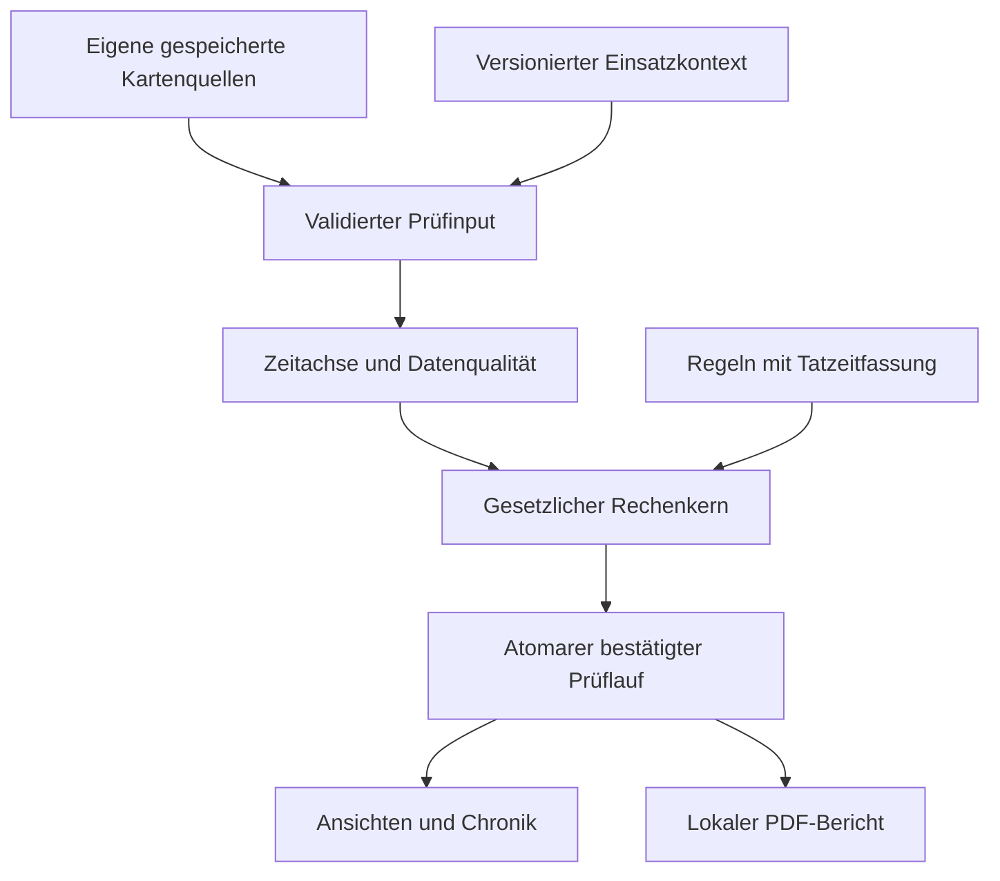

# FahrerTagebuch 1.0 – Plan für die zeitbezogene Verstoß-Engine

**Stand: 14.10.2026. ENTWURF ZUR PRÜFUNG. Keine Umsetzungsfreigabe, keine Engine implementiert.**

Die technischen und fachlichen Arbeitspakete, Datenverträge, Regelmatrix, Teststrategie und Abnahmekriterien sind hier zusammengeführt. Gesetzliche Einzelheiten mit noch ausstehender Primärquellen- oder unabhängiger Fachprüfung sind ausdrücklich als Freigabepunkte ausgewiesen. Die Planung darf nicht als bereits geprüfte vollständige Rechtsberechnung ausgegeben werden.

## 1. Verbindliche Grundlage und Lesereihenfolge

1. [Historische80 Entscheidungen und A–H](VIOLATION_ENGINE_PRODUCT_DECISIONS_80.md), unverändert erhalten.
2. [Verbindliche Ergänzungen E01–E12](VIOLATION_ENGINE_PRODUCT_ADDENDUM_20261014.md): bei Produktwidersprüchen vorrangig; [Änderungsübersicht](VIOLATION_ENGINE_PLAN_CHANGES_20261014.md) mit sämtlichen betroffenen Planstellen.
3. Dieses Dokument: Architektur, Datenbedarf, Umsetzungspakete und Freigaben.
4. [Gesetzliche Regelmatrix](VIOLATION_ENGINE_LEGAL_MATRIX.md):58 Regelzeilen, historischer Rechtsstand, Anwendbarkeitsgrenzen, Zeitsonderregeln, Schweregrade und Quellen.
5. [Testmatrix](VIOLATION_ENGINE_TEST_MATRIX.md):116 fachliche Mindestfälle und43 Daten-/Technikfälle (ursprünglich98/31 plus18/12), PD01–PD80 und ergänzende E01–E12-Zuordnung;20 Abnahmekriterien (ursprünglich16 plus4).

Die vollständig übergebenen Nachrichten sind die Quelle; der spätere Abschlussauftrag präzisiert beziehungsweise ersetzt nur seine ausdrücklich betroffenen älteren Formulierungen. Gesetze haben Vorrang vor Produktentscheidungen. **PR #88 bleibt Entwurf; Planaktualisierung ist keine Implementierungs- oder Releasefreigabe.**

**Version1.0:** vollständige anwendbare zeitbezogene561/2006-Berechnung für regulären professionellen Güterverkehr und unterstützten Linien-/Gelegenheitsbusverkehr, einschließlich Verlängerungen, Reduzierungen, Anrechnung, Ausgleich und bestätigten Sonderregeln. E09 begrenzt aktive Spezialbetriebskataloge; nachgewiesen nicht anwendbare oder unzuverlässig einzuordnende Einsätze erhalten keine unberechtigten EU-Befunde, Budgets oder Entwarnungen. Anwendbare nationale/temporäre Abweichungen werden nicht durch die Produktgrenze aufgehoben, sondern bei konkreter Betroffenheit berücksichtigt oder als Prüfgrenze ausgewiesen.

AETR/TCA, eigenständige nationale Arbeitszeitgesetze, tatsächlicher Ruheort, tatsächliche Heimkehrprüfung, DDD-Standardexport und Lohn/Spesen/Abrechnung bleiben außerhalb. Keine komplette Reiseverwaltung oder umfangreichen Dialoge für seltene Spezialbetriebe als Engine-Voraussetzung.

Der jetzt ausdrücklich beauftragte **lokale PDF-Verstoßbericht** ist Teil von 1.0. Er ist eine eigene Berichtsart; bisher gestrichene Abrechnungs-/Lohnexporte werden dadurch nicht wieder beauftragt.

Die Grundeinrichtung soll knapp bleiben: Einsatzart und Anzeigepräferenzen; juristisch relevante Zusatzangaben nur, wenn sie einen konkreten anstehenden Befund oder ein Budget verändern. Keine allgemeine Pflichtbefragung zu sämtlichen Handwerks-/Agrar-/Kommunal-Ausnahmen. Die gesetzliche Matrix dient der sachlichen Abgrenzung; sie schreibt keinen umfassenden Spezialausnahme-Onboardingdialog vor.

## 2. Tatsächlich übernommene technische Basis

Bei ursprünglicher Übernahme: main `df7061659b621d67ff39ac2f02f44e13d7ac4e86`, Übergabe-PR #87 gemergt, zunächst keine offenen PRs. Bei Start dieses Ergänzungsauftrags erneut live bestätigt: main unverändert; einziger relevanter offener Draft-PR #88 auf `235839c152936d3e13a97cbc7f3c7e76de2ee1b6`, dessen Docs-CI38590591817 erfolgreich, keine laufende CI zu diesem Kopf. Letzte volle Produkt-main-CI38559255131, Versuch1, alle vier Jobs erfolgreich. Das sind historische Ausgangsnachweise, keine Abnahme der neuen Planung oder einer Engine. Aktuellen neuen PR-Kopf/CI vor Abschluss live prüfen.

40128: Produkt-PR #85, Merge `c4057b3810d1ad0f5ef8e27cf69b260acd9c8405`, identischer Produktbaum zum CI-/Gerätekopf `7f5f770aa71ec70bb8f02d51cae3403a6f904637`. Eigene Abnahme Tobi14.10.2026 13:47. Room22, Compilerexport-SHA256 `e555aec9e6b1db51372db348c2afc57d6a38a0889df26642b7ef8cee3e4eef4f`. Alle späteren bisherigen main-Änderungen betreffen Dokumentation. Mathematische Signaturprüfung abgeschlossen, Zertifikatsvertrauen NOT_EVALUATED.

| Bestehender Baustein | Geprüfter Bestand | Konsequenz |
|---|---|---|
| `:domain` | Vorhandene Android-Library mit Domaintypen; keine 561/2006-Engine gefunden | Plattformunabhängige Kotlin-Rechenlogik in diesem Modul ergänzen, ohne neues Modul als Vorbedingung. |
| `:data` | SQLCipher/Keystore, Room22, Profil-/Karten-/Parent-/Child-Bindung | Quellenadapter und getrennte abgeleitete Persistenz hier; keine Änderung alter Herkunftsfingerprints. |
| `CardActivityParser` / EF0504 | UTC-Tage, minutengenaue Wechsel, Tätigkeit, Steckplatz, Kartenstatus und c-Bit | Dekodierung wiederverwenden; Kontextbedeutung der Bits korrekt ableiten, keine Datenkopie als neue Originalquelle. |
| `NormalizedCardActivityStore`, `DriverActivityDao` | Unveränderliche Tage/Wechsel, Quellenverknüpfung und abweichende Tagesversionen | Input aus exakten Beziehungen, Deduplizierung auf abgeleiteter Zeitachse; Originale bleiben getrennt. |
| `CardSpecificConditionParser/Store` / EF0522 | G1/G2/V2, OOS-/Fähr-/Zugmarker; G1 ohne zwingenden Endmarker | Punktmarker wiederverwenden; keine automatische Ruhe oder erfundene Reiseintervalle. |
| `CardLoadTypeParser/Store` / EF0530 | Nur GEN2V2; Güter/Personen/undefiniert/unbekannt | Zeitgebundene Verkehrsquelle; Linien-/Gelegenheitsart und weitere Voraussetzungen aus gezieltem Kontext. |
| `DriverCardImportRepository` | `get` validiert genaue Sitzung; `all/latest` filtern auf Primäranwendung | Für Engine nicht ungeprüft `all()` als vollständigen Eingang nutzen. Beide Anwendungen über vorhandene Batch-/Child-Beziehungen laden. |
| `DriverCardImportPipeline` | Äußere atomare Gruppenpersistenz, einzelne SAVED/PARTIAL-Runs und getrennte Fehlerfälle | Ein Anstoß erst nach Commit des gesamten akzeptierten Imports, nicht mitten im ersten Child. |
| `CardDayTimeline` | Darstellungsprojektion mit letzter Aktivität bis UTC-Tagesende | Kein unmittelbarer juristischer Input; aktueller Tag und Kartenentnahme benötigen gesonderten Endnachweis. |
| `CardDaySpecificConditionMarkers` | Quellen-/Kartengebundene Punktprojektion, reale Zeitachse bei DST | Marker und Navigation wiederverwenden; gesetzliche Anrechnung bleibt separate Ableitung. |
| `TimeContext.REPORT_ZONE` | Fest Europe/Berlin als Altbestand | Einstellbare Anzeigezone als eigene Präferenz; kein Einfluss auf Rechtsdauer/-woche. |
| `:report/ReportGateway` | NoOp-Platzhalter, keine PDF-Implementierung | Lokalen Verstoßbericht neu ergänzen; keine bestehende fertige Exportfunktion behaupten. |
| `:feature` und `:app` | Bestehende Vorschau-/Detail-/Importflächen, keine vollständige 1.0-Ansicht | Engine-Verträge zuerst; nötige Anzeigen gezielt ergänzen, danach geplanter Kalender-/Auswertungs-/UI-Umbau. |

Quellpfade sind relativ zum Repository. Das vorhandene Repository benutzt teilweise alte Produktnamen und Altformulare; sie begründen keine Rückkehr zu gestrichenen Funktionen.

## 3. Architektur und Datenfluss

Die Engine verarbeitet einen eingefrorenen, nachvollziehbaren Datenstand. Sie kennt weder freie Kalender-/Schichtgruppierung noch Android-Ansichten, USB, SQL oder Gerätestandort.

| Modul | Geplante Verantwortung |
|---|---|
| `:domain` | Input-/Ergebnisverträge, Kontext-/Rechtsfassungstypen, Intervallalgebra, Lenk-/Pausen-/Ruhe-/Wochen-/Ausgleichsberechnung und prüfbarer Rechenweg. Nur feste Eingaben, keine Systemuhr. |
| `:data` | Eigene validierte Quellen lesen, Kontextrevisionen verwalten, Daten-/Regelrevisionen bilden, Lauf anstoßen, aktuelle Revision atomar veröffentlichen und Audit/Lesestatus speichern. |
| `:feature` / `:app` | Hauptübersicht, Verstoß-/Hinweis-/Qualitätsdetails, Zeitstrahlnavigation, Anzeigezone/Schichtgruppierung, gezielte Kontextdialoge, Betafehlerformular/Diagnose. |
| `:report` | Bericht aus bestätigtem Ergebnis-/Quellensnapshot, Layout und lokale PDF-Erzeugung. Android-Dateispeichern/Teilen erfolgt bewusst über UI. |
| `:core` | Vorhandene gemeinsame Darstellung/Formatierung nach Bedarf; keine zweite juristische Engine. |

Geplante logische Schritte:
1. Profil und exakte eigene Quellen prüfen; beschädigte oder fremde Quellen getrennt zurückweisen.
2. Alle relevanten bestätigten Import-/Batch-/Child-Quellen in einem konsistenten Read-Snapshot laden.
3. Semantik der Kartenbits, bekannte Intervalle, Quellenkonflikte und regelbezogene Prüfbarkeit ableiten.
4. Rechtsraum und zeitlich gültige Einsatzkontexte auflösen, geeignete Regelpakete zuordnen.
5. Tages-/Wochenlenkzeit, Pausen und tägliche Ruhe mit jeweils eigenem Anker berechnen.
6. Wochenruhe-Zuordnung und Ausgleich gemeinsam über die nötigen Zweier-/Vierwochenfenster lösen.
7. Sonderfälle und rechtlich sichere Schweregrade ergänzen; unklare Daten/Anwendbarkeit als Hinweise behandeln, E07-Lenküberschreitungen mit klarer offener Rechtsbewertung sichtbar halten.
8. Numerisch belegte Befunde mit getrennter rechtlicher Einordnung, einzelne Verpflichtungen, sichere Budgets und Rechenwege erzeugen.
9. Nur den weiterhin aktuellen Snapshot in einer kurzen Schreibtransaktion veröffentlichen.

Lange Berechnungen laufen außerhalb von Room-Transaktionen auf einem Rechen-Dispatcher. Cancellation wird weitergereicht. Jeder Quellen-/Kontext-/Regelwechsel invalidiert ältere Ergebnisse. Technischer Fehler ist weder Rechtsverstoß noch Ergebnis „alles in Ordnung“.

## 4. Eingangsdaten und Provenienz

Der geplante Prüfinput enthält:
- vorhandenes Fahrerprofil und zulässige eigene Karten;
- deduplizierte Tätigkeitsintervalle mit originalem Quelltyp, Karten-/Generations-/Anwendungs-/Parent-/Child-/Import-/Datei-/Recordbezug;
- tatsächliche Zeitauflösung und endbegründende Quelle pro Intervall;
- EF0522-Punktmarker, EF0530-Verkehrseinträge und vorhandene relevante Fahrzeug-/Länder-/GNSS-/Ortsdaten;
- für die jeweiligen Rechtsregeln notwendige Kontextangaben mit Gültigkeitszeitraum, Erfassungsherkunft und Revision;
- belegten Datenstichtag pro Quelle/Regel, Lücken, Konflikte und ausgeschlossene Rechtsräume;
- Regelpaket-ID/hash, Interpretationsversion, Tatzeitfassungen und Engineversion.

Historische Quellen werden nicht ersetzt. Die Engine darf als aktuelle **abgeleitete** Zeitprojektion belegte kompatible Erweiterungen verschiedener Imports verwenden. Sie darf dabei niemals alte Sitzungsbelege umschreiben oder eine jüngere Quelle als ursprünglichen Beleg ausgeben.

### 4.1 Ein Zeitverlauf aus mehreren eigenen Quellen

Deduplizierung ist keine Datenvernichtung:
- Identische Tätigkeiten aus GEN1 und GEN2/GEN2V2 zählen einmal und behalten alle Quellen.
- Primäranwendung allein ist keine vollständige Konfliktprüfung; bestehende Child-Zuordnungen beider Anwendungen verwenden.
- Gleiche Zeit mit widersprüchlichen Aktivitäten wird ein Konfliktsegment, nicht „jüngste Quelle gewinnt“.
- Unterschiedliche Ringpositionen oder Import-IDs ergeben nicht automatisch verschiedene Tätigkeiten.
- Echte spätere Nachträge am Fahrtenschreiber können einen alten ungeklärten Zeitraum belegen; Vorher/Nachher wird abgeleitet neu bewertet und protokolliert.
- Eigene bestätigte Ersatzkarten gehören zum Fahrerprofil. Fremde Karten und nicht belegtes Altarchiv bleiben getrennt.

### 4.2 Kontextabhängige EF0504-Bedeutung

Der Parser bewahrt das c-Bit aktuell unter dem Feldnamen `crewDriving`. Für Fahrerkarten unterscheidet Appendix 1 §2.1:
- Karte eingesetzt: c=0 Solo, c=1 Crew.
- Karte nicht eingesetzt: c=0 folgende Tätigkeit unbekannt, c=1 bekannte am Fahrtenschreiber manuell eingetragene Tätigkeit.
- Kartenentnahme hat eine eigene Punktbedeutung; ausgewählte Tätigkeit an diesem Punkt beweist keine Tätigkeit/Ruhe für den folgenden ganzen Zeitraum.
- Bei nicht eingesetzter Karte sind bestimmte Slot-/Aktivitätsfelder nicht als normaler Crew-/Aktivitätsbeleg verwendbar.

Es wird ein **lesender semantischer Adapter** auf den erhaltenen Bits und Quellen geplant. Vorhandene Parser-/Fingerprint-/Schemawerte bleiben unverändert. Keine Übernahme von `crewDriving=true` bei `cardInserted=false` als Beweis für Mehrfahrerbetrieb. Normale Kartennachträge werden rechtlich als vorhandene aufgezeichnete Tätigkeiten berücksichtigt; das App-Verbot manueller Ergänzungen verbietet nicht ihre Auswertung.

E02 genehmigt jetzt ausdrücklich die **dezente Beschriftung „Manueller Nachtrag am EG-Kontrollgerät“**, klein oberhalb der betroffenen Tätigkeit beziehungsweise im Tätigkeitsdetail. Sie folgt der tatsächlichen semantischen Quelle, bleibt bei Kalender-/Schicht-/Zonenwechsel am richtigen Intervall und wird nicht als Warnung/Verstoß dargestellt. Bekannte manuelle Arbeit/Ruhe wird wie entsprechende andere aufgezeichnete Tätigkeit gerechnet; unbekannte Entnahmefolgen erhalten diese Kennzeichnung nicht und bleiben unbekannt. Die frühere Aussage „keine genehmigte Kennzeichnung“ ist überholt, siehe Änderungsübersicht. Appendix-/Entnahme-/Mitternachtsabgleich und UI-Tests bleiben M0/M1/M5-Gates.

### 4.3 Belegter Datenstichtag und offene Enden

Es gibt kein pauschales `letztes Kartendatum +24 h` und kein `jetzt()` als juristisches Ende:
- Ein bekannter Tätigkeitsabschnitt endet am nächsten belegten passenden Wechsel; verlässlich abgeschlossene Kartentagesgrenzen nur nach dokumentierter Semantik verwenden.
- Entnahme/ungeklärter Folgestatus beendet die sicher belegte fortlaufende Tätigkeit. Nachträgliche Wiedereinträge können die Lücke später tatsächlich schließen.
- Ältere, längst entnommene Karte wird durch neuen App-Import nicht bis zum Importzeitpunkt aktiv.
- Import-`startedAt/finishedAt` sind im aktuellen Code Speicher-/Verarbeitungszeiten nach dem Kartenlesen, kein bereits belegter EF-Lese-/Aufzeichnungsstichtag.
- EF0507 enthält Sitzungsbeginn, kein Nutzungsende und keinen aktuellen Karten-Datenzeitstempel.
- Ohne vorhandenen genügenden Endnachweis bleibt der letzte Teil offen/unklar. Eindeutige bereits aufgezeichnete Überschreitungen davor bleiben bewertbar.

Sollte für ein konkretes Budget eine zusätzliche **Erfassungsmetadatenmessung am bestehenden Lesepfad** nötig werden, wird sie in M1 separat begründet und mit unveränderten Hardware-/CI-/Gerätegates umgesetzt. Keine neue Karte-APDU oder Erfindung vergangener Metadaten daraus ableiten. Geräte-Uhrzeit allein wird auch dann kein Beweis für fortgesetzte Kartentätigkeit.

## 5. Einsatzprofil und gezielte Zusatzangaben

| Kontext | Geplanter minimaler Datenbedarf / Auslöser |
|---|---|
| Grundprofil | Güter-/Personenverkehr sowie notwendige Bestätigung des regulierten Einsatzes; vom Betrieb wechselnde Einsätze zeitgebunden getrennt. Maßgebliche Parameter nur fragen, wenn nicht schon belegt. |
| Personenverkehr | Vorhandene EF0530 zuerst; noch ungeklärte Personenbeförderung einmal gezielt Linien-/Gelegenheitsart fragen. Für ≤50-km-Ausnahme tatsächliche Linienlänge erforderlich. |
| Mehrfahrer | Korrekte gesteckte Karten-/Crew-/Slotaufzeichnungen grundsätzlich für ihren zeitlichen Umfang verwenden. Keine Routinefrage „zweiter Fahrer anwesend?“, keine allgemeine Bestätigung, keine Pflicht zur zweiten Karte. Erstes-Stunden-Recht, folgende Crewqualifikation und konkrete Widersprüche/Lücken aus Chronik; einzelnes Bit nicht auf unbekannte Zeit ausweiten. |
| Internationale Güter-Wochenruhe | Niederlassungsstaat, Wohnsitzland und belegte Beginne beider Reduzierungen außerhalb beider Staaten. Nur entscheidende fehlende Länder gezielt fragen, gültige Antworten wiederverwenden. Keine Adresse/Heimstandort/Heimradius/Ortung. |
| Gelegenheitsbus | Nur konkret benötigte Dienst-/Tourkennung, belegte Dauer und besondere technische Nacht-/Nachweismerkmale. Kein verpflichtendes Reiseverwaltungsmodul, keine Reiseroute/Teilnehmer-/Buchungsverwaltung. Fehlender Sondernachweis führt zur erklärten Prüfgrenze, nicht erfundener Ausnahme. |
| Fähre/Zug | EF0522 wiederverwenden. E04/P01 entschieden: fehlender konkret entscheidender gesetzlicher Schlafplatz/Fahrplan optional gezielt, nicht nach jedem Import, erfragen. Antwort zeitbezogen mit Quellen speichern und bei unverändertem Sachverhalt wiederverwenden; keine allgemeine Unterkunftsprüfung. |
| Out of Scope / Sonderausnahme | Originalmodus plus getrennte rechtliche Einordnung. Belegte Nichtanwendbarkeit respektieren; konkrete unsupported/unklare Art.3/11/13/14-Konstellation betroffene Prüfung begrenzen. Keine Vollkataloge und großen Spezialbetriebseinrichtungsdialoge. |
| Anreise nach Art.9 Abs.2–3 | Nur bestehende aufgezeichnete Zeit plus nötiges Kontextmerkmal; keine manuelle Aktivitätszeitleiste oder Heimkehrberechnung. |
| Artikel12 | E07/P02 entschieden: normale rechnerische Lenküberschreitung in Übersicht/PDF; numerisch passende1-/2-h-Fälle mit Hinweis und offener rechtlicher Bewertung. Keine tatsächliche Heimkehrprüfung, Nutzeranerkennung, Pflichtbegründung, automatische Rechtfertigung oder automatische Ausgleichsschuld. |

Kontextdaten erhalten `validFrom/validTo`, Erfassungszeit, Revision und Quellenart. Ein später verändertes Standardprofil überschreibt nicht automatisch alle früheren Einsätze. Widersprüche zwischen Karte und Kontext werden konkret erklärt; Benutzerkontext darf eine aufgezeichnete Fahrt nicht löschen. Bereits beantwortete gezielte Fragen werden über Kontextart, betroffenen Einsatz-/Ruhe-/Dienstzusammenhang und gültige Revision wiedererkannt. Ein unveränderter erneuter Import stellt keine neue Frage; veränderte entscheidende Tatsachen dürfen die konkrete fehlende Angabe erneut klären. Eine Schlafplatzantwort zu einer Reise gilt nicht unbegrenzt für andere Reisen.

Anzeigezone, Sprache und Kalender-/Schichttagmodus sind **Darstellungspräferenzen**, kein rechtlicher Einsatzkontext. Ihr Wechsel darf keine inhaltliche Neubewertung oder neue „Neu“-Markierung erzeugen.

## 6. Berechnung und Beweisgrenzen

Der Berechnungshorizont folgt Abhängigkeiten, nicht dem 28-Tage-Anzeigefilter. Benötigt werden unter anderem letzte relevante tägliche/wochentliche Ruhe, Verlängerungsvorgänge der Rechtswoche, Vorwoche, alle maßgeblichen überlappenden Zwei-/Vierwochenfenster, Ursprung und Frist offener Ausgleiche sowie Tourzusammenhang. Je nach Lage kann dafür deutlich mehr Historie erforderlich sein. Fehlender Beginn bleibt eine konkrete Prüflücke.

Datenqualität wird **pro Regel und Zeitraum** bewertet. Eine Lücke macht nicht automatisch alles unprüfbar. Eine rechtlich bestätigte Verletzung erfordert hinreichend belegten Tatbestand, Grenzwert und entscheidende Ausnahmevoraussetzungen. E07 erlaubt bei hinreichend belegter normaler Lenkzeitgrenze ausdrücklich den sichtbaren rechnerischen Befund mit offener Artikel-12-Rechtsbewertung; unzureichende Tätigkeits-/Scope-Daten werden dadurch nicht zu sicherem Zahleninput.

Kein Restbudget ohne verlässliche Obergrenze beziehungsweise vollständige nötige Vorgeschichte. Nachgewiesene Mindestfahrt über einer Grenze kann einen Befund stützen, aber nur innerhalb eines wirklich bestimmbaren rechtlichen Fensters; über eine mögliche qualifizierende Ruhe darf nicht blind kumuliert werden.

Lenk-/Pausen-/Tagesruhe-Anker sind getrennt. Die Q13-7-h-Vollzugskonvention zur täglichen Lenkzeit ist keine legal ausreichende Ruhe. Wochenruhezuordnung, Ausgleich und Sonderregeln müssen gemeinsam eine gesetzeskonforme Lösung über alle betroffenen Fenster finden. Zusätzliche Rastblöcke werden nicht automatisch als neue Pflichtreduzierungen behandelt.

### 6.1 Wochenruhe und Ausgleich als gemeinsame Zuordnung

Ruheblöcke chronologisch auswerten, dann rechtlich zulässige Wochen-/Pflichtzuordnungen gemeinsam über alle relevanten Zweier-/Vierwochenfenster und Fristen prüfen. Ein Sonntag/Montag überschneidender Block gehört nur einer Woche. Eine alternative zulässige Zuordnung darf nicht durch voreiliges FIFO einen falschen Verstoß erzeugen. Deterministische Auswahl und verworfene rechtlich relevante Alternativen im Rechenbeleg erläutern; unentscheidbare Alternativen bleiben transparent.

Jede Ausgleichspflicht besitzt Ursprung, angerechnete Reduzierung/Woche, Betrag, exakte Frist und zugeordnete zusammenhängende Zusatzruhe. Zusatzintervalle nicht doppelt verwenden; gesetzlicher Grundruheblock und Ausgleich getrennt ausweisen. Bei internationaler24+25-Reduzierung liegen21+20 vor der folgenden≥45-h-Regelruhe; deren Beginn bleibt innerhalb144 h nach tatsächlichem vorherigem Wochenruheende. Deshalb muss das86-h-Gesamtpaket spätestens nach103 h beginnen. Zusätzliche24–<45-h-Rasten nicht automatisch als neue Pflichtreduzierung buchen.

**23-h-Ruhe:** tägliche Ruhe-/Lenkanker korrekt fortsetzen, aber Wochenruheanker/144-h-Frist und Reduzierungszähler zwischen Wochenruhen nicht als erfüllt zurücksetzen. Keine automatische22-h-Wochenruheschuld. Ein fortbestehender verspäteter Wochenruhebeginn wird als eine Episode vom maßgeblichen Wochenruheanker/Fristbeginn geführt. Erneuter Import, weiterer Kalendertag oder neue Darstellungsgruppe erzeugt keinen identischen zusätzlichen Befund. Eigenständige überlappende Wochenpaarverletzung oder andere gesetzliche Pflicht bleibt separat prüfbar. Eine neue W02-Episode setzt einen neuen tatsächlichen rechtlichen Anker voraus.

Erfüllte Pflichten verlassen die offene Übersicht, bleiben mit Erfüllungsquelle/Frist/Audit erhalten. Später tatsächlich genommene Ruhe heilt eine schon eingetretene Fristverletzung nicht. Später importierte **damalige** Daten oder geänderter relevanter Kontext können dagegen eine frühere unvollständige/falsche Bewertung berichtigen; diese Neubewertung wird protokolliert.

### 6.2 Artikel12: sichere Zahl, offene Rechtsbewertung

**E07 ersetzt die frühere ausschließliche Behandlung als ausgelagerten Prüfhinweis; P02 ist geschlossen.** Zuerst alle normalen verfügbaren Verlängerungen/Sonderregeln anwenden. Beispielsweise9:25 h mit freiem10-h-Vorgang ist kein Überschreitungsfall. Erst der Überschuss gegenüber dem tatsächlich zulässigen normalen Tages-/Wochenlenkwert wird als rechnerischer Befund berechnet.

Für seit20.08.2020 einschlägige Tages-/Wochenlenkgrenzen nach Art.6 Abs.1/2: `0 < Überschuss ≤60 min` mit möglicher Ein-Stunden-Regel, `60 < Überschuss ≤120 min` mit möglicher Zwei-Stunden-Regel erläutern. Genau0 erzeugt keinen Überschreitungsbefund. Mehr als120 min ist kein Kandidat allein für diese spezielle Zahlenspanne; daraus folgt kein pauschaler Ausschluss des anders geregelten Art.12 Abs.1.90-h-Doppelwochen-, Pausen- oder Wochenruhefristverletzungen werden nicht durch diesen speziellen Zahlenhinweis gerechtfertigt. Alte Tatzeiten bekommen keine rückwirkende2020-Ausnahme.

Der Befund bleibt in der Verstoßübersicht und im PDF, etwa **„Lenkzeitüberschreitung: +1 Stunde 30 Minuten“**, mit sichtbarer **offener rechtlicher Bewertung** und folgendem Zusatz:

> Unter bestimmten außergewöhnlichen Umständen kann eine Abweichung nach Artikel 12 der VO (EG) Nr. 561/2006 zulässig sein. Ob die gesetzlichen Voraussetzungen erfüllt sind, wurde von FahrerTagebuch nicht geprüft.

Die zwei Aussagen sind getrennt: normale Grenze numerisch überschritten; Rechtmäßigkeit einer tatsächlichen Ausnahme nicht geprüft. Keine als gesichert rechtswidrig beschriftete Kategorie oder bestätigter rechtlicher Schweregrad aus dem Zahlenbereich allein. Startzusammenfassung/PDF zählen solche Einträge ausdrücklich als rechnerische Überschreitungen mit offener Bewertung, nicht als abschließend bestätigte Rechtsverstöße. Kein neuer Statusfilter.

Details erläutern1 h für Wochenruhe gegenüber2 h für **regelmäßige** Wochenruhe, Rückkehrzweck, außergewöhnliche Umstände/Verkehrssicherheit, unmittelbar vorherige≥30-min-Pause der2-h-Regel zusätzlich zu weiter geltendem Art.7, vorgeschriebene externe Dokumentation, bedingten zusammenhängenden Ausgleich bis Ende der dritten Folgewoche und nicht aufgehobene Grenzen. Das ist kein App-Begründungs-/Anerkennungsdialog. Keine automatische Heimkehrprüfung/Ortung und keine automatisch entstandene Artikel-12-Ausgleichsschuld. Weitere Datenlücken oder unklare Anwendbarkeit bleiben eigenständige Prüfhindernisse; eine unbestimmbare Normalgrenze darf nicht zu einer erfundenen Zahl führen.

Bei offenen Fenstern wird bereits eindeutig feststehende Überschreitung ausgegeben. Noch rechtzeitig erfüllbare Ruhe-/Ausgleichspflichten werden als Verpflichtung oder Warnung gezeigt. Budgets und Warnungen sind an den letzten belegten Stand gebunden, ohne Live-Countdown zur Smartphone-Uhr.

## 7. Ergebnisvertrag und stabile Ereignisse

| Ergebnis | Erforderlicher Inhalt |
|---|---|
| Rechnerischer Befund / rechtlich gesicherte Verletzung | Stabile fachliche Ereignis-ID, Regel/Artikel/Absatz/Tatzeitfassung, betroffene Zeitspanne/Grenzpunkt, tatsächlicher/zulässiger Wert, Lenküberschuss/Ruhefehlmenge/Fristverspätung, angewendete Erleichterungen, Rechenweg/Provenienz. Numerische Feststellung und rechtliche Einordnung getrennte Felder; E07-Kandidat sichtbar mit offener Bewertung, gesicherter rechtlicher Schweregrad nur bei hinreichend belegter Rechtswidrigkeit. |
| Prüfhinweis | Konkrete Datenlücke, Quellenkonflikt, fehlende Anwendbarkeits-/Sondervoraussetzung oder nicht unterstützte Sonderkonstellation mit Auswirkungen/optional gezielter Klärung. Kein erfundener „ungeklärter Verstoß“. E07-Zahlenbefund mit offener Artikel-12-Bewertung bleibt zusätzlich sichtbar in der Verstoßübersicht. |
| Offene Verpflichtung | Wochenruhe/Ausgleich mit eindeutigem Ursprung, geschuldeter ungeteilter Menge, genauer Fälligkeit/Anbindung und unabhängigen Zusatzruhe-Zuweisungen. Erfüllung verlässt offene Liste, bleibt nachvollziehbar; keine tatsächliche Artikel-12-Schuld aus bloßem Kandidaten. |
| Sicheres Budget | Regel-ID, Restmenge/Frist und Stichtag; keine künstliche Zahl bei unzureichender Datenlage. |
| Datenabdeckung | Bekannte/unbekannte/konfliktbehaftete Perioden und regelbezogene Auswirkungen; nicht allein Prozentsatz der importierten Tage. |
| Prüflauf | Profil, Quelle-/Kontext-/Regel-/Engineversion, Inputdigest, belegter Auswertungsstichtag, Erstellungszeit, technische Fertigstellung und bestätigte Ergebnisrevision. |

Ereignisidentität basiert auf Fahrerprofil, Regel und fachlichem Rechtsfenster/Anker; Import-ID und Schweregrad gehören nicht als alleiniger Schlüssel hinein. Bei nachträglich veränderten Grenzen sind Vorgänger-/Nachfolgerbeziehungen nachvollziehbar. Keine doppelte ID für gleiche Rechtsverletzung aus zweiter Anwendung; neue rechtlich eigenständige Verletzung bleibt erhalten. W02-Episoden behalten ihren Ursprung statt täglich neue IDs zu erhalten; E07-Hinweis ändert nicht die Identität derselben Zahlenüberschreitung.

Die Maße sind absichtlich getrennt: 25 min zusätzliche Fahrt ist nicht 25 min gesamte kalendarische Ereignisspanne; 30 min fehlende Ruhe ist nicht 30 min Fahren. Gruppierung verändert keinen gesetzlichen Einzelbefund.

## 8. Persistenz und Migration

Diese Planung verändert **kein Schema**. Die erste genehmigte Persistenzimplementierung benötigt voraussichtlich eine additive Migration von22 auf den nächsten echten Compilerstand (bei unverändertem Ausgangsstand voraussichtlich23). Die Versionsnummer ist vor Beginn am tatsächlichen main zu bestimmen.

Vorgesehene getrennte Tabellen/Verträge, endgültiges SQL erst nach Freigabe:
- versionierte profilgebundene Einsatzkontexte und deren Gültigkeitsintervalle;
- Prüfläufe mit Inputs/Regelmanifest/Revision und bestätigtem aktuellem Lauf;
- einzelne Befunde, Rechenwege und genaue Quellenreferenzen;
- Ausgleichs-/Verpflichtungsledger mit eindeutigen Zuweisungen;
- regelbezogene Datenqualitäts-/Hinweisbereiche;
- Audit-Vorher/Nachher mit Änderungsgrund;
- lokaler Gelesenstatus für „Neu“.

Bestehende Tabellen, Originalbytes, Reader-Receipts, Karten-/Sitzungs-/Request-/Quellen-/Zertifikatsfingerprints, Aufnahmestatus, alte Imports und getrenntes Altarchiv bleiben unverändert. Quellen der Engine werden nicht rückwirkend in alte Import-Requests hineingeschrieben. Keine Klartext-Zweitdatenbank, destruktive Migration oder handgefertigte Room-JSON-Datei.

Schreibtransaktion publiziert einen ganzen aktuellen Lauf samt zugehöriger Ledgers/Audit konsistent. Bei einem zwischenzeitlichen neuen Import/Kontext-/Regelwechsel darf ein älterer laufender Job nicht publizieren. Audit und Lesestatus bleiben erhalten; reine Replayläufe erzeugen keine künstlichen Neubewertungen.

## 9. Auslöser, Rechenphase und Audit

Nach erfolgreichem Commit einer gesamten eigenen Importgruppe: neuen Quellenstand prüfen und automatisch ausführen; auch akzeptierter Teilimport löst regelbezogene Neubewertung mit seinen echten Lücken aus. Keine Berechnung auf uncommitteten Child-Daten. Doppelte Aufnahme ohne neuen fachlichen Input kann deterministisch wiederverwendet beziehungsweise ohne neue Meldung berechnet werden.

Relevanter Kontextedit oder reguläres Update des Regelpakets löst Neubewertung aus. Alle sichtbaren alten Verstoß-/Warn-/Budget-/Detail-/Exportinhalte werden gemäß Entscheidung69 vorübergehend ausgeblendet; stattdessen verständlich „Prüfung wird aktualisiert“. Alter Lauf bleibt als Historie erhalten, ist währenddessen kein aktuelles Ergebnis.

Technische Laufzustände sind interne Arbeitszustände, kein Statusfilter für Verstöße. Bei Abbruch/Fehler erscheint ein technischer Hinweis mit datensparsamer Ursache; erforderliche erneute Berechnung ist sichtbar. Nach Prozessneustart wird ausstehende aktuelle Bewertung kontrolliert fortgesetzt, ohne den normalen Importverlust-/Cancellationvertrag zu verändern.

Audit enthält:
- vorherigen und neuen Befund/Grundwert/Rechtsstand beziehungsweise neues/entfallenes Ereignis;
- Ursache: neue Quelle, tatsächlich vervollständigter Karten-Nachtrag, Kontextänderung, Rechts-/Interpretationsänderung oder Fehlerkorrektur;
- genaue betroffene Input-/Kontextrevisionen, alte/neue Läufe und Datum;
- keine unmaskierten Rohdaten oder beliebigen Exceptiontexte.

„Neu“ gibt es für erstmals nach Import erkannte numerisch gesicherte Ereignisse, einschließlich E07-Befund mit klar offener rechtlicher Bewertung, bis deren Detail angesehen wurde. Ein bloßer Datenlückenhinweis wird dadurch kein Verstoß. Eine reine Mengen-/Schweregradänderung desselben früheren Befunds erzeugt keinen prominenten Änderungsbanner. Neubewertungen durch Kontext-/Regelwechsel stehen im Audit; nicht eigenmächtig als neue Importmeldung darstellen.

## 10. Ansichten und chronologische Zuordnung

Geplanter Startumfang: kompakte Verstoßübersicht, deutliche Datenlücken-/Prüfhinweise, verbrauchte/verbleibende Tagesverlängerungen und Reduzierungen, Wochen- und Doppelwochenbudgets getrennt sowie Wochenruhefrist erst bei freigegebener Relevanzschwelle. Restfahrt bis Art.-7-Pause bleibt im Detail. E07-Einträge in der Zusammenfassung ausdrücklich als rechnerische Überschreitungen mit offener Bewertung kennzeichnen, nicht in eine unqualifizierte Zahl „gesicherter Rechtsverstöße“ hineinrechnen.

Verstoßhistorie: jüngste28Tage als Anzeigevorgabe, freie Zeitraumwahl und Artfilter, neueste Ereignisse zuerst. Typgruppen nach jüngstem Einzelereignis; zusammenhängende Sachverhalte dürfen mehrere rechtlich eigenständige Befunde enthalten. Kein Statusfilter und keine zusätzlichen verpflichtenden Schnellbuttons.

Details enthalten fachliche Berechnung und konkreten Gesetzesverweis, angewendete Tatzeitfassung, exakte Intervalle, Sonderregel-Voraussetzungen sowie aufklappbare technische Quellen. Maskierung nach jedem Auswahlwechsel erneut setzen. Zertifikatsvertrauen bleibt ungeprüft; mathematische Belege aus40128 nur wiederverwenden. Bekannte Kontrollgeräte-Nachträge erhalten die kleine E02-Beschriftung am tatsächlichen Segment/in dessen Detail; normale Tätigkeitsfarbe bleibt, keine alarmierende Verstoßdarstellung.

Kalendertag-/Schichttagmodus gruppiert dieselben Instant-basierten Daten anders. Im Schichtmodus Datum des tatsächlichen Schichtbeginns; eine ungeklärte Lücke wird nicht still zur neuen Schichtgrenze. **Produktpräzisierung P05:** reine Darstellungsgrenze bei fehlendem klaren Schichtanker bestimmen; gesetzliche Ruhe-/Lenkanker bleiben davon getrennt. Mitternacht und Sommer-/Winterzeit mit tatsächlichem UTC-Offset markieren. Detailnavigation hebt Grenzpunkt plus gesamten betroffenen Quellenzeitraum hervor.

Keine positive Gesamtmeldung bei unvollständig geprüftem ausgewähltem Zeitraum oder relevanten offenen Hinweisen. Bei ausreichender Abdeckung kurze sachliche positive Meldung; keine Behauptung einer allgemeinen amtlichen Freigabe.

## 11. Lokaler PDF-Verstoßbericht

Jede Erstellung beginnt mit **neuer aktiver Zeitraumwahl**, ohne still übernommene Historienauswahl. Name ist standardmäßig ausgeschaltet. Export verwendet nur einen konsistenten aktuellen bestätigten Prüflauf; während Neuberechnung ist Erzeugung gesperrt.

Erste Seite: Zeitraum, Stichtag, Anzeigezone, berücksichtigter Rechtsbereich und konkret relevante Datenlücken/Prüfgrenzen. Danach alle Befunde, nötigenfalls über mehrere Seiten: Ereigniszeitraum/Grenzpunkt, Rechenweg, Werte/Mengen, Regel/Artikel/Absatz und jeweils tatsächlich angewendete Gesetzesfassung. Gemischte historische Rechtsstände niemals mit einer einzigen pauschalen aktuellen Fassung beschriften.

Aufgeführte Source-Referenzen sind maskiert. Berichtsgrundlage und Exportzeit werden getrennt; ausgeblendete Fahrernamen erscheinen auch nicht in Dateimetadaten. E07-Zahlenbefunde bleiben vollständig enthalten: Überschreitung, Normalgrenze, Zeitzuordnung, Hinweistext und offene rechtliche Bewertung am Einzelbefund. Kein bestätigter Rechtswidrigkeits-Schweregrad und kein irreführender Summenzähler; bestätigte Verletzungen und rechnerische Überschreitungen mit offener Bewertung sprachlich unterscheiden. Offene Ausgleichspflichten/sonstige Prüfhilfen getrennt, keine automatische Artikel-12-Schuld aus Kandidaten. Ein leerer, aber unvollständiger Zeitraum darf keinen „keine Verstöße bestätigt“-Bericht erzeugen.

Android: bewusstes lokales Speichern über vorhandenes Dateiauswahlprinzip beziehungsweise geeigneten App-Export; optional Teilen über `ACTION_SEND`, Content-URI mit begrenztem Leserecht. Keine automatische Weitergabe. PDF-Render-/Inhaltsprüfung gehört zu M6; vorhandener `:report`-Platzhalter wird nach Freigabe als eigene Berichtsart erweitert.

## 12. Offline-Regelupdates, Diagnose und Betatest

Mitgeliefertes Regelmanifest hat ID/hash, juristische Quellen, fachliche Interpretationsversion, Wirksamkeitsintervalle und tatsächlich unterstützte reguläre Rechtsräume/Zeitfassungen und ausdrücklich abgegrenzte Sonderkonstellationen; keine Pflicht zu sämtlichen Spezialkatalogen nach E09. Regeln kommen über reguläre App-Updates. Keine Online-Regelabhängigkeit, Remote-Konfiguration oder automatische Änderung der Gesetze aus einem unbestätigten Webabruf.

Vorhandene installierte Regelabdeckung und neuere mögliche Ausnahmen werden nicht als universell aktuell behauptet. Ein historischer Einsatz außerhalb des geprüften Katalogs bleibt als Einschränkung sichtbar. Vor jedem Release unterstützte Regelabdeckung, Anwendbarkeitsgrenzen und relevante neuere Rechtsänderungen erneut fachlich prüfen.

Geschlossene Beta etwa5–10Lkw-Fahrer; Busregeln trotzdem vollständig fachlich und technisch abnehmen, ohne Bus-Hardwarebeta zu behaupten. Lokale technische Diagnoseansicht: aktuelle Regel-/Inputrevision, Stichtag, ausgeführte Regelgruppen, technische Fehlercodes und maskierte Quellenreferenzen. Fachliche Testabdeckungsberichte bleiben interne Entwicklungsnachweise und sind nicht als allgemeines Produktgütesiegel sichtbar.

Fehlerformular in der App: Beschreibung und notwendige technische Versionsangaben; Diagnosen nur optional, datensparsam, mit Vorschau und ausdrücklicher Testerzustimmung. Kein automatischer Rohkarten-/Standortupload, keine vollständigen APDUs. **P04:** Zustell-/Exportweg vor Umsetzung auswählen; neues Backend/Konto/Service wird nicht vorausgesetzt. Alle1.0-Texte auf Deutsch.

Unabhängige rechtliche Fachprüfung benötigt eine tatsächlich qualifizierte externe Person/Organisation und dokumentierte Ergebnisse. Modell-Selbstaudit oder Betafahrer ersetzt diese Prüfung nicht. Kontaktaufnahme/Datensendung ist in diesem Plan nicht autorisiert.

## 13. Umsetzungspakete nach gesonderter Freigabe

Die Reihenfolge hält die Engine als nächsten Produktschwerpunkt fest. Kalender-/Auswertungs-/grundlegender UI-Neuaufbau folgen anschließend; gezielt notwendige Engine-Anzeigen entstehen innerhalb der jeweiligen Pakete.

| Paket | Abhängigkeit und konkreter Umfang | Prüfgate vor Folgepaket / Merge |
|---|---|---|
| M0 – Fachliche Spezifikation schließen | Vor Rechenkern: amtliche Fassungen/Fundstellen/Wirksamkeit pinnen, L01–L09 für jeweilige Regelgruppe schließen, unabhängige Goldenfälle; P03–P05 vor betroffener UI/Fehlerberichtsarbeit entscheiden. E02–E10/P01/P02 nicht erneut zur Produktwahl stellen. | Noch ausschließlich Dokumentation/Fachprüfung. Tobi muss den konkreten Plan ausdrücklich zur Implementierung freigeben. Release-Fachgesamtprüfung bleibt nochmals M7. |
| M1 – Eingang und Herkunft | Nach freigegebenem M0-Datenvertrag: lesende0504-Semantik, beide Quellen, Stichtage, Scope-Guard, Duplikate/Konflikte, gezielter Kontext mit Antwortwiederverwendung, getrennte abgeleitete Persistenz. | A01–A06 sowie Eingangs-/Herkunftsanteile A17/A18; passende DT-Quellenfälle. LG99/LG100 zunächst als freigegebene Vektoren, tatsächlicher Rechtsnachweis in M2/M3, UI-Anteil A17 in M5. Eigene volle CI; Import-/Persistenz-/Migrationsänderung braucht eigene Geräteabnahme vor Merge. |
| M2 – Lenkzeit und Pausen | Nach M1 + M0 zu S/D/B: D01–D06/B01–B05, gesetzliche Woche, aufgezeichnete Crew-/Beifahrerpause, historische Buspausen; E07-Normalgrenzwerte. | A03/A07/A08 und Pausenanteil A18; LG17–LG39 sowie Normalgrenzen-/Zahlenteile LG111–LG113, deren E07-Anzeigen erst M5/M6. Keine Teilengine als1.0 freigeben. |
| M3 – Tägliche Ruhe und Sonderfälle | Nach M1/M2 + M0 zu R/F: R01–R07/F01–F05, Crew30 h, Bus25 h, Fährnettoruhe, offene Fenster und23-h-Tagesanker. | A03/A07/A08 und vollständiger Ruheanteil A18, Tagesankeranteil A19; LG40–LG57/LG81–LG88/LG99/LG100/LG109/LG110, Tagesanteil LG101–LG103. Wochenanteile danach M4. |
| M4 – Wochenruhe und Ledger | Nach M1–M3 + M0 zu W: W01–W14, gemeinsame Alternativzuordnung, mehrere Schulden/Einmaligkeit, internationale rollierende Vierwochen- und Bus-Zwölftageregel, stabile Episoden. | A07/A09/A19; LG58–LG80/LG101–LG108/LG114–LG116, DT37/DT38, unabhängige Frist-/Solvergoldenfälle. |
| M5 – Ergebnis, Audit und Ansichten | Nach M2–M4 + L06/L07: sichere Budgets, Rechts-/Zahlenbefunde inklusive E07, rechtlich passende Schweregrade, atomare Neubewertung/Neu, Datenqualität, manuelle E02-Kennzeichnung und Navigation. P03/P05 entschieden. | A10–A12/A17–A20 im UI-/Ergebnisumfang; PD/E-Zuordnung, Compose und entsprechende DT32–DT43-Anteile. PDF-Anteil A20/DT40 erst M6. Passende Gerätebestätigung, spätestens jeder dritte Produkt-PR. |
| M6 – PDF und Beta-Werkzeuge | Nach bestätigten M5-Ergebnisverträgen und P04: lokale Berichte inklusive offener Artikel-12-Bewertung, Zeitraum/Name/Abdeckung, bewusste sichere Weitergabe, Diagnose/Fehlerformular. | A13/A14/A20; gerenderte/inhaltliche PDF-Fälle und echte Gerätefälle. |
| M7 – Gesamtprüfung und Releaseentscheidung | Nach allen Paketen: komplette Golden-/Regression-/Offline-/Performancefälle, unabhängige rechtliche Gesamtprüfung, geschlossene Beta5–10Berufskraftfahrer, Abschlussdokumentation. | Sämtliche A01–A20 und unveränderte technische/CI-/Gerätegates. Fehlerblocker geschlossen. Eigene Releasefreigabe durch Tobi. |

Ein paketübergreifendes A-Kriterium erhält hier ausdrücklich **Teilnachweise**: M1 Eingang/Herkunft, M2/M3 Rechtsberechnung, M4 Wochen-/Ledgerregeln, M5 UI/Audit, M6 PDF. Kein späterer UI-/PDF-Nachweis ist Vorbedingung für die davorliegende Quellenimplementierung. A01–A20 müssen vor M7 insgesamt erfüllt sein; technische CI-/Gerätegates jedes betreffenden Produkt-PRs gelten vollständig. Diese Staffelung schwächt kein Kriterium ab.

M1–M6 können mehrere kleine Produkt-PRs erfordern; Grenzen werden anhand des tatsächlichen Diffs und benötigter Geräteabnahme gesetzt. Keine künstliche Bündelung zur Umgehung der „spätestens jeder dritte Produkt-PR“-Regel. Für die Planungsfreigabe wird **keine feste VersionsCode-Folge** oder CI-Laufzeit versprochen.

## 14. Verbindliche Abnahmekriterien

Alle Kriterien sind für die vorgesehene Implementierung verpflichtend; jetzt ist keines als neue Engine-Abnahme erfüllt.

| ID | Abnahmekriterium |
|---|---|
| A01 | Alle80Entscheidungen/A–H plus E01–E12 rückverfolgbar; historische Quelle unverändert, betroffene überholte Planformulierungen explizit dokumentiert. |
| A02 | Bestehende40128-Basis, Parser/Originale/Profil-/Anwendungs-/Sitzungsbindung und Kryptografiegrenzen erhalten. Engine-Modifikationen schreiben keine Karte und erzeugen keine neue Signatur-/Trustbehauptung. |
| A03 | Vollständige anwendbare Zeitregeln innerhalb E08/E09 sowie sichere Begrenzung unsupported Einsätze; amtliche Fassungen/Wirksamkeit und Interpretationsgoldenfälle fachlich bestätigt. L01–L09 vor jeweils abhängiger Regel schließen, keine Vollkatalogpflicht seltener Betriebe. |
| A04 | Datenstichtag, Kartenentnahme, bekannte Kartennachträge, Crewbits und aktuelle Tagesenden belegt; kein künstliches Verlängern bis Mitternacht/Importzeit/jetzt. |
| A05 | Gleichartige eigene Zeitquellen zählen einmal, Konflikte sichtbar; historischer Beleg unverändert, kein jüngerer Ersatz oder Altarchiv-Backfill. |
| A06 | Additive echte SQLCipher-/Room-Migration und Reopen/Replay/Rollback; alte Original-/Receipt-/Fingerprintzeilen unverändert. Schema ausschließlich Compilerexport, keine Sicherheitsabschwächung. |
| A07 | Jede Regel Positiv/Negativ/Grenze/Lücke/Kontext-/Versionswechsel geprüft; unabhängige Erwartungen, ganze Abläufe und Mehrregel-Goldenfälle. 9:25 mit verfügbarer Verlängerung erzeugt keinen Tagesverstoß. |
| A08 | Rechtswerte/IDs/Pflichten unabhängig von Anzeigezone, Kalender-/Schichtmodus und28-Tage-Anzeige; tatsächliche Dauern aus UTC-Intervallen, keine zusätzliche lokale DST-Dauerrechnung. Gesetzliche Wochen/Nachtfenster gesondert; DST-/Mitternachtsmarker korrekt. |
| A09 | Globale Wochenzuordnung/Einmalausgleich und exakte Fristen, mehrere Schulden, Zusatzruhe, W08-Ausgleiche vor Regelruhe und Bus-Nachruhe korrekt. Erfüllte Pflicht aus offener Übersicht entfernt, Herkunft/Erfüllung/Audit erhalten. |
| A10 | Zahlengesicherte Überschreitung, rechtlich bestätigte Verletzung, Warnung und Prüflücke klar erkennbar; E07-Zahlenbefund bleibt Liste mit offener Bewertung. Richtige Überschuss-/Fehlmengen-/Verspätungsgröße, keine falsche Entwarnung/unsicheres Budget. |
| A11 | Kontext-/Import-/Regeländerungen atomar neu berechnet; alte Ergebnisse ausgeblendet, verspätete Läufe abgewiesen; Audit Vorher/Nachher/Grund und korrekter Gelesen-/Neu-Zustand. |
| A12 | Schweregrade nur bei eindeutig belegter rechtlicher Verletzung und passender amtlicher Tatzeittabelle; keine Bußgelder/Ersatzklassen. Offener E07-Kandidat hat keinen bestätigten rechtlichen Verstoßgrad und keine automatische Rechtfertigung/Schuld. |
| A13 | Vollständiger lokaler PDF mit neuer Zeitraumwahl, standardmäßig ohne Name, Lücken auf Seite1, Einzelrechtsständen und allen Details; visuell und inhaltlich geprüft, sichere optionale Android-Weitergabe. |
| A14 | Offlinebetrieb, Deutsch, minimaler gezielter Kontextfluss, Beta-Fehlerformular/Diagnose mit Vorschau+Zustimmung und Datenminimierung abgenommen. |
| A15 | Alle bisherigen technischen Gates plus eigene passende vollständige CI und Geräteabnahme für endgültigen Produktbaum; keine Testfilter/Quarantäne/Budget-/Workflow-/Upload-/Mergeabschwächung. |
| A16 | Unabhängige qualifizierte rechtliche Gesamtprüfung, dokumentierte Beta5–10Fahrer, alle fachlichen Fehler korrigiert; keine Veröffentlichung vor eigener Releasefreigabe. |
| A17 | Bekannte manuelle Kontrollgeräte-Tätigkeit rechtlich normal anrechnen und dezent mit exakt „Manueller Nachtrag am EG-Kontrollgerät“ im Zeitstrahl/Detail kenntlich machen. Unbekannte Folge weder Ruhe noch manuelle Bekannt-Tätigkeit; c-Bit/Kartenstatus korrekt, Originale unverändert. |
| A18 | Aufgezeichnete Crewzeiten grundsätzlich nutzen:30-h-Tagesruhe und besondere Beifahrerpause, keine Routine-Anwesenheitsabfrage, Zweitkarte oder allgemeine Bestätigung. Lücken/Einzelbits nicht auf ganze unbekannte Perioden ausdehnen; gesetzliche Voraussetzungen/konkrete Widersprüche korrekt erklären. |
| A19 | 23-h-Ruhe als geeignete tägliche, nicht wöchentliche Ruhe; Tageslenk-/Ruheanker fortsetzen, Wochenfrist/Reduzierungszähler nicht fälschlich erfüllen, keine erfundene22-h-Schuld. Fortbestehende Wochenepisode nicht täglich/je Import duplizieren; eigenständige Regeln erhalten. |
| A20 | Artikel-12-Kandidaten in Übersicht, Details, Zeitstrahl und PDF mit exaktem Zahlenüberschuss und klar offener Rechtsbewertung;0/60/120/+1-min-Grenzen und Tatzeit korrekt. Keine gesicherte Rechtswidrigkeit/Schweregrad/Artikel-12-Schuld oder Heimkehrprüfung aus Zahlen. Summen/positive Meldungen und PDF enthalten keine irreführende Entwarnung. |

Falsche Verstoßmeldung, falsche Entwarnung, falsches Restbudget, fehlerhafte Ruhe-/Ausgleichszuordnung, verlorener/verwechselter Herkunfts-/Auditbezug oder fehlende Trennung von Zahlenüberschreitung und offener Artikel-12-Rechtsbewertung blockieren das betreffende Produktpaket beziehungsweise Release. Fehlende Geräte- oder Fachabnahme wird nicht durch reine Docs-CI ersetzt.

Die unveränderten sieben Gradle-Aufrufe sind: `help`, `build --dry-run`, `test`, `lint`, `assembleDebug`, `assembleInternal`, `:app:assembleDeviceTest`. Hinzu kommen APK-/Testsignatur-/Updatepaar-/echte Compiler-Schemavergleiche, vollständige API36-SQLCipher-/Compose-Suiten und Abschlussjob. Erfolgreiche normale CI lädt weiterhin keine Artefakte hoch; Fehlerdiagnostik drei Tage. Gerätepakete ausschließlich bewusst für exakten geprüften Kopf.

## 15. Noch offene Produktpräzisierungen

**P01 und P02 sind durch E04/E07 produktseitig geschlossen.** Sie bleiben als historische IDs in der Änderungsübersicht nachvollziehbar, gehören nicht mehr in die offenen Produktfragen. Noch nicht ausdrücklich festgelegt sind nur folgende drei Präzisierungen; ihre Vorschläge sind keine bereits beschlossenen Anforderungen.

| ID | Tatsächlich offene Produktfrage | Konkreter Vorschlag zur Prüfung |
|---|---|---|
| P03 | Ab wann wird „Wochenruhefrist rückt näher“ sichtbar, und wann erscheint die tägliche Frühwarnung? | Übersichtsvorschlag: Wochenruhe bei≤24 h bis frühest erforderlichem gesetzlichen Beginn, tägliche Warnung bei≤2 h bis letztmöglichem legalem Ruhebeginn, immer am Datenstichtag. Keine zusätzlichen gesetzlichen Grenzwerte. Vor M5 entscheiden. |
| P04 | Wie stellt der Tester den App-Fehlerbericht bewusst zu? | Lokales Formular mit Berichtsexport/Android-Teilen, ohne neues Backend. Konkreter Empfänger/Kanal nur nach gesondertem Auftrag; keine automatische Nachricht. Vor M6 entscheiden. |
| P05 | Wie wird im Schichtmodus ein nicht belegbarer Schichtbeginn dargestellt? | Geeigneter tatsächlich belegter Ruhe-Endanker nur für Darstellung; sonst ungeklärte Zuordnung anzeigen, kein erfundenes Datum. Kein Rechtszählerreset. Vor M5 entscheiden. |

Getrennt davon sind **L01–L09 fachliche Nachweise**, keine erneut offenen Produktentscheidungen. Die [gesetzliche Matrix](VIOLATION_ENGINE_LEGAL_MATRIX.md) nennt Quelle, Auslegung und Umfang; die [Änderungsübersicht](VIOLATION_ENGINE_PLAN_CHANGES_20261014.md) ordnet sie den M0-/Releasegates zu. Für M7 sind tatsächliche Nachweise zu unabhängigem fachkundigem Prüfer, Beta-Teilnehmern und ihren Ergebnissen erforderlich; eine solche neue Engine-Gesamtabnahme ist im Repository nicht dokumentiert. Dieser Plan autorisiert keine Kontaktaufnahme oder Datensendung.

## 16. Aktueller Dokumentationsauftrag und nächste Freigabe

Jetzt ausschließlich:
- Anforderungen dokumentieren, Quellen-/Codebestand abgleichen und überprüfbaren Plan ausarbeiten;
- Dokumente auf isoliertem Branch sichern, reine Docs-Prüfungen ausführen und als Draft-PR zur Diskussion vorlegen;
- WORK_START/STATUS/HANDOFF/CURRENT_RULES gezielt aktualisieren, ohne alte Sicherheits-/CI-/Gerätevorgaben abzuschwächen.

**Keine Engine-, Kalender-, PDF-, Datenbank-, Parser-, Reader- oder UI-Implementierung in dieser Sitzung.** Keine neue APK, Schemaänderung oder Produktversion. Bestehende Checkouts/Branches und offene Settings-Datei mit hashgleicher Sicherung bleiben erhalten.

Zuerst Tobi: aktualisierten Gesamtplan und tatsächlich offene P03–P05 prüfen. Danach offene fachliche M0-Nachweise schließen und den betreffenden konkret implementierbaren Stand zur ausdrücklichen Freigabe vorlegen. Eine reine Plan-/Docs-Zustimmung wird weder als umfassende Hardwarefreigabe noch als ungeprüfte Releasefreigabe behandelt. Der Nutzer kann den Umsetzungsspielraum ausdrücklich erweitern; diese Vorlage enthält selbst keine solche Autorisierung.
