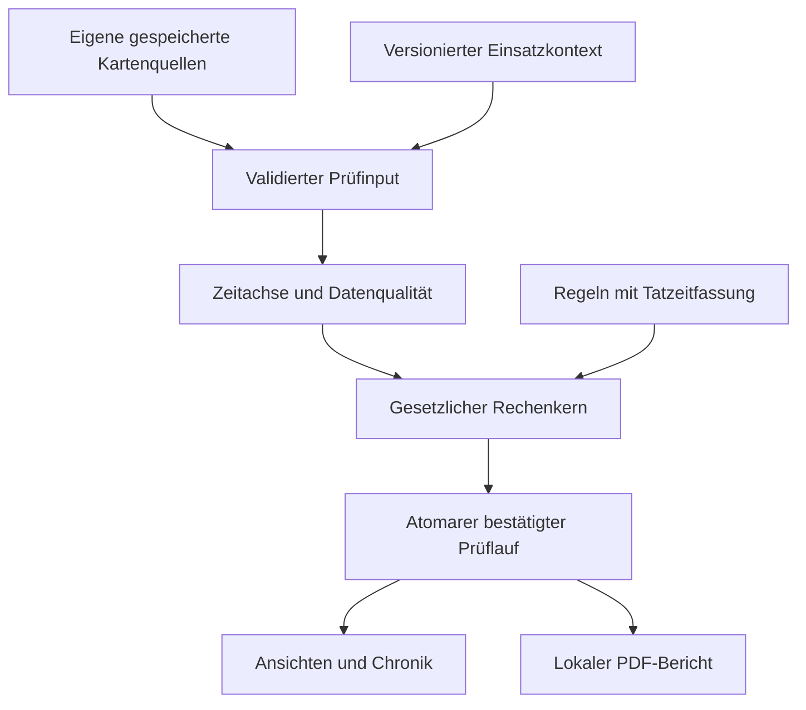

# FahrerTagebuch 1.0 – Plan für die zeitbezogene Verstoß-Engine

**Stand: 14.10.2026. ENTWURF ZUR PRÜFUNG. Keine Umsetzungsfreigabe, keine Engine implementiert.**

Die technischen und fachlichen Arbeitspakete, Datenverträge, Regelmatrix, Teststrategie und Abnahmekriterien sind hier zusammengeführt. Gesetzliche Einzelheiten mit noch ausstehender Primärquellen- oder unabhängiger Fachprüfung sind ausdrücklich als Freigabepunkte ausgewiesen. Die Planung darf nicht als bereits geprüfte vollständige Rechtsberechnung ausgegeben werden.

## 1. Verbindliche Grundlage und Lesereihenfolge

1. [80 Produktentscheidungen und Grundsätze A–H](VIOLATION_ENGINE_PRODUCT_DECISIONS_80.md): übernommene Anforderungsquelle, nicht durch diesen Plan ersetzt.
2. Dieses Dokument: Architektur, Datenbedarf, Arbeitspakete und Freigaben.
3. [Gesetzliche Regelmatrix](VIOLATION_ENGINE_LEGAL_MATRIX.md): 57 Regelzeilen, historische Wirksamkeit, Geltungsbereiche, Ausnahmegruppen, Schweregrade und Quellen.
4. [Testmatrix](VIOLATION_ENGINE_TEST_MATRIX.md): 98 fachliche Mindestfälle, 31 Daten-/Technikfälle und vollständige Zuordnung PD01–PD80; zusätzliche parametrierte Ausnahme-/Grenzfälle verpflichtend.

Die vollständige neue Nachricht ist bei Formulierungsunterschieden maßgeblich gegenüber der beigefügten früher formulierten Anlage. Die Anlage bleibt unverändert. Planung und anschließende Implementierung sind getrennte Freigabeschritte.

**Version 1.0:** sämtliche für die unterstützten Einsätze anwendbaren zeitbezogenen Regeln der VO 561/2006 einschließlich zulässiger Verlängerung/Reduzierung, Pause, täglicher und wöchentlicher Ruhe, Ausgleich und Sonderkonstellationen. AETR/TCA, eigenständige nationale Arbeitszeitgesetze, Bewertung des tatsächlichen Ruheortes, DDD-Standardexport und Lohn-/Spesen-/Abrechnung bleiben außerhalb. Nationale Abweichungen innerhalb des 561/2006-Regimes dürfen nicht allein wegen dieses Ausschlusses ignoriert werden.

Der jetzt ausdrücklich beauftragte **lokale PDF-Verstoßbericht** ist Teil von 1.0. Er ist eine eigene Berichtsart; bisher gestrichene Abrechnungs-/Lohnexporte werden dadurch nicht wieder beauftragt.

Die Grundeinrichtung soll knapp bleiben: Einsatzart und Anzeigepräferenzen; juristisch relevante Zusatzangaben nur, wenn sie einen konkreten anstehenden Befund oder ein Budget verändern. Keine allgemeine Pflichtbefragung zu sämtlichen Handwerks-/Agrar-/Kommunal-Ausnahmen. Die gesetzliche Matrix dient der sachlichen Abgrenzung; sie schreibt keinen umfassenden Spezialausnahme-Onboardingdialog vor.

## 2. Tatsächlich übernommene technische Basis

Liveprüfung vor und nach der Pause: main `df7061659b621d67ff39ac2f02f44e13d7ac4e86`, Übergabe-PR #87 gemergt, keine offenen PRs. Letzte Docs-CI38562576031 erfolgreich. Letzte volle Produkt-main-CI38559255131, Versuch1, alle vier Jobs erfolgreich. In dieser Planung noch keine neuen fachlichen Engine-Tests ausgeführt.

40128: Produkt-PR #85, Merge `c4057b3810d1ad0f5ef8e27cf69b260acd9c8405`, identischer Produktbaum zum CI-/Gerätekopf `7f5f770aa71ec70bb8f02d51cae3403a6f904637`. Eigene Abnahme Tobi14.10.2026 13:47. Room22, Compilerexport-SHA256 `e555aec9e6b1db51372db348c2afc57d6a38a0889df26642b7ef8cee3e4eef4f`. Alle späteren bisherigen main-Änderungen betreffen Dokumentation. Mathematische Signaturprüfung abgeschlossen, Zertifikatsvertrauen NOT_EVALUATED.

| Bestehender Baustein | Geprüfter Bestand | Konsequenz |
|---|---|---|
| `:domain` | Vorhandene Android-Library mit Domaintypen; keine 561/2006-Engine gefunden | Plattformunabhängige Kotlin-Rechenlogik in diesem Modul ergänzen, ohne neues Modul als Vorbedingung. |
| `:data` | SQLCipher/Keystore, Room22, Profil-/Karten-/Parent-/Child-Bindung | Quellenadapter und getrennte abgeleitete Persistenz hier; keine Änderung alter Herkunftsfingerprints. |
| `CardActivityParser` / EF0504 | UTC-Tage, minutengenaue Wechsel, Tätigkeit, Steckplatz, Kartenstatus und c-Bit | Dekodierung wiederverwenden; Kontextbedeutung der Bits korrekt ableiten, keine Datenkopie als neue Originalquelle. |
| `NormalizedCardActivityStore`, `DriverActivityDao` | Unveränderliche Tage/Wechsel, Quellenverknüpfung und abweichende Tagesversionen | Input aus exakten Beziehungen, Deduplizierung auf abgeleiteter Zeitachse; Originale bleiben getrennt. |
| `CardSpecificConditionParser/Store` / EF0522 | G1/G2/V2, OOS-/Fähr-/Zugmarker; G1 ohne zwingenden Endmarker | Punktmarker wiederverwenden; keine automatische Ruhe oder erfundene Reiseintervalle. |
| `CardLoadTypeParser/Store` / EF0530 | Nur GEN2V2; Güter/Personen/undefiniert/unbekannt | Zeitgebundene Verkehrsquelle; Linien-/Gelegenheitsart und weitere Voraussetzungen aus gezieltem Kontext. |
| `DriverCardImportRepository` | `get` validiert genaue Sitzung; `all/latest` filtern auf Primäranwendung | Für Engine nicht ungeprüft `all()` als vollständigen Eingang nutzen. Beide Anwendungen über vorhandene Batch-/Child-Beziehungen laden. |
| `DriverCardImportPipeline` | Äußere atomare Gruppenpersistenz, einzelne SAVED/PARTIAL-Runs und getrennte Fehlerfälle | Ein Anstoß erst nach Commit des gesamten akzeptierten Imports, nicht mitten im ersten Child. |
| `CardDayTimeline` | Darstellungsprojektion mit letzter Aktivität bis UTC-Tagesende | Kein unmittelbarer juristischer Input; aktueller Tag und Kartenentnahme benötigen gesonderten Endnachweis. |
| `CardDaySpecificConditionMarkers` | Quellen-/Kartengebundene Punktprojektion, reale Zeitachse bei DST | Marker und Navigation wiederverwenden; gesetzliche Anrechnung bleibt separate Ableitung. |
| `TimeContext.REPORT_ZONE` | Fest Europe/Berlin als Altbestand | Einstellbare Anzeigezone als eigene Präferenz; kein Einfluss auf Rechtsdauer/-woche. |
| `:report/ReportGateway` | NoOp-Platzhalter, keine PDF-Implementierung | Lokalen Verstoßbericht neu ergänzen; keine bestehende fertige Exportfunktion behaupten. |
| `:feature` und `:app` | Bestehende Vorschau-/Detail-/Importflächen, keine vollständige 1.0-Ansicht | Engine-Verträge zuerst; nötige Anzeigen gezielt ergänzen, danach geplanter Kalender-/Auswertungs-/UI-Umbau. |

Quellpfade sind relativ zum Repository. Das vorhandene Repository benutzt teilweise alte Produktnamen und Altformulare; sie begründen keine Rückkehr zu gestrichenen Funktionen.

## 3. Architektur und Datenfluss

Die Engine verarbeitet einen eingefrorenen, nachvollziehbaren Datenstand. Sie kennt weder freie Kalender-/Schichtgruppierung noch Android-Ansichten, USB, SQL oder Gerätestandort.

| Modul | Geplante Verantwortung |
|---|---|
| `:domain` | Input-/Ergebnisverträge, Kontext-/Rechtsfassungstypen, Intervallalgebra, Lenk-/Pausen-/Ruhe-/Wochen-/Ausgleichsberechnung und prüfbarer Rechenweg. Nur feste Eingaben, keine Systemuhr. |
| `:data` | Eigene validierte Quellen lesen, Kontextrevisionen verwalten, Daten-/Regelrevisionen bilden, Lauf anstoßen, aktuelle Revision atomar veröffentlichen und Audit/Lesestatus speichern. |
| `:feature` / `:app` | Hauptübersicht, Verstoß-/Hinweis-/Qualitätsdetails, Zeitstrahlnavigation, Anzeigezone/Schichtgruppierung, gezielte Kontextdialoge, Betafehlerformular/Diagnose. |
| `:report` | Bericht aus bestätigtem Ergebnis-/Quellensnapshot, Layout und lokale PDF-Erzeugung. Android-Dateispeichern/Teilen erfolgt bewusst über UI. |
| `:core` | Vorhandene gemeinsame Darstellung/Formatierung nach Bedarf; keine zweite juristische Engine. |

Geplante logische Schritte:
1. Profil und exakte eigene Quellen prüfen; beschädigte oder fremde Quellen getrennt zurückweisen.
2. Alle relevanten bestätigten Import-/Batch-/Child-Quellen in einem konsistenten Read-Snapshot laden.
3. Semantik der Kartenbits, bekannte Intervalle, Quellenkonflikte und regelbezogene Prüfbarkeit ableiten.
4. Rechtsraum und zeitlich gültige Einsatzkontexte auflösen, geeignete Regelpakete zuordnen.
5. Tages-/Wochenlenkzeit, Pausen und tägliche Ruhe mit jeweils eigenem Anker berechnen.
6. Wochenruhe-Zuordnung und Ausgleich gemeinsam über die nötigen Zweier-/Vierwochenfenster lösen.
7. Sonderfälle und rechtlich sichere Schweregrade ergänzen; unklare Bedingungen als Hinweise ausgeben.
8. Belegbare Befunde, Verpflichtungen, sichere Budgets und Rechenwege erzeugen.
9. Nur den weiterhin aktuellen Snapshot in einer kurzen Schreibtransaktion veröffentlichen.

Lange Berechnungen laufen außerhalb von Room-Transaktionen auf einem Rechen-Dispatcher. Cancellation wird weitergereicht. Jeder Quellen-/Kontext-/Regelwechsel invalidiert ältere Ergebnisse. Technischer Fehler ist weder Rechtsverstoß noch Ergebnis „alles in Ordnung“.

## 4. Eingangsdaten und Provenienz

Der geplante Prüfinput enthält:
- vorhandenes Fahrerprofil und zulässige eigene Karten;
- deduplizierte Tätigkeitsintervalle mit originalem Quelltyp, Karten-/Generations-/Anwendungs-/Parent-/Child-/Import-/Datei-/Recordbezug;
- tatsächliche Zeitauflösung und endbegründende Quelle pro Intervall;
- EF0522-Punktmarker, EF0530-Verkehrseinträge und vorhandene relevante Fahrzeug-/Länder-/GNSS-/Ortsdaten;
- für die jeweiligen Rechtsregeln notwendige Kontextangaben mit Gültigkeitszeitraum, Erfassungsherkunft und Revision;
- belegten Datenstichtag pro Quelle/Regel, Lücken, Konflikte und ausgeschlossene Rechtsräume;
- Regelpaket-ID/hash, Interpretationsversion, Tatzeitfassungen und Engineversion.

Historische Quellen werden nicht ersetzt. Die Engine darf als aktuelle **abgeleitete** Zeitprojektion belegte kompatible Erweiterungen verschiedener Imports verwenden. Sie darf dabei niemals alte Sitzungsbelege umschreiben oder eine jüngere Quelle als ursprünglichen Beleg ausgeben.

### 4.1 Ein Zeitverlauf aus mehreren eigenen Quellen

Deduplizierung ist keine Datenvernichtung:
- Identische Tätigkeiten aus GEN1 und GEN2/GEN2V2 zählen einmal und behalten alle Quellen.
- Primäranwendung allein ist keine vollständige Konfliktprüfung; bestehende Child-Zuordnungen beider Anwendungen verwenden.
- Gleiche Zeit mit widersprüchlichen Aktivitäten wird ein Konfliktsegment, nicht „jüngste Quelle gewinnt“.
- Unterschiedliche Ringpositionen oder Import-IDs ergeben nicht automatisch verschiedene Tätigkeiten.
- Echte spätere Nachträge am Fahrtenschreiber können einen alten ungeklärten Zeitraum belegen; Vorher/Nachher wird abgeleitet neu bewertet und protokolliert.
- Eigene bestätigte Ersatzkarten gehören zum Fahrerprofil. Fremde Karten und nicht belegtes Altarchiv bleiben getrennt.

### 4.2 Kontextabhängige EF0504-Bedeutung

Der Parser bewahrt das c-Bit aktuell unter dem Feldnamen `crewDriving`. Für Fahrerkarten unterscheidet Appendix 1 §2.1:
- Karte eingesetzt: c=0 Solo, c=1 Crew.
- Karte nicht eingesetzt: c=0 folgende Tätigkeit unbekannt, c=1 bekannte am Fahrtenschreiber manuell eingetragene Tätigkeit.
- Kartenentnahme hat eine eigene Punktbedeutung; ausgewählte Tätigkeit an diesem Punkt beweist keine Tätigkeit/Ruhe für den folgenden ganzen Zeitraum.
- Bei nicht eingesetzter Karte sind bestimmte Slot-/Aktivitätsfelder nicht als normaler Crew-/Aktivitätsbeleg verwendbar.

Es wird ein **lesender semantischer Adapter** auf den erhaltenen Bits und Quellen geplant. Vorhandene Parser-/Fingerprint-/Schemawerte bleiben unverändert. Keine Übernahme von `crewDriving=true` bei `cardInserted=false` als Beweis für Mehrfahrerbetrieb. Normale Kartennachträge werden rechtlich als vorhandene aufgezeichnete Tätigkeiten berücksichtigt; das App-Verbot manueller Ergänzungen verbietet nicht ihre Auswertung.

Die Appendix-Fassung und Entnahme-/Mitternachtsfälle werden in M0/M1 vollständig gegengeprüft. Eine zusätzliche auffällige UI-Kennzeichnung manueller Kartennachträge ist keine stillschweigend erfundene 81. Entscheidung; technische Herkunft kann nach Entscheidung35 im Quellenbereich erläutert werden.

### 4.3 Belegter Datenstichtag und offene Enden

Es gibt kein pauschales `letztes Kartendatum +24 h` und kein `jetzt()` als juristisches Ende:
- Ein bekannter Tätigkeitsabschnitt endet am nächsten belegten passenden Wechsel; verlässlich abgeschlossene Kartentagesgrenzen nur nach dokumentierter Semantik verwenden.
- Entnahme/ungeklärter Folgestatus beendet die sicher belegte fortlaufende Tätigkeit. Nachträgliche Wiedereinträge können die Lücke später tatsächlich schließen.
- Ältere, längst entnommene Karte wird durch neuen App-Import nicht bis zum Importzeitpunkt aktiv.
- Import-`startedAt/finishedAt` sind im aktuellen Code Speicher-/Verarbeitungszeiten nach dem Kartenlesen, kein bereits belegter EF-Lese-/Aufzeichnungsstichtag.
- EF0507 enthält Sitzungsbeginn, kein Nutzungsende und keinen aktuellen Karten-Datenzeitstempel.
- Ohne vorhandenen genügenden Endnachweis bleibt der letzte Teil offen/unklar. Eindeutige bereits aufgezeichnete Überschreitungen davor bleiben bewertbar.

Sollte für ein konkretes Budget eine zusätzliche **Erfassungsmetadatenmessung am bestehenden Lesepfad** nötig werden, wird sie in M1 separat begründet und mit unveränderten Hardware-/CI-/Gerätegates umgesetzt. Keine neue Karte-APDU oder Erfindung vergangener Metadaten daraus ableiten. Geräte-Uhrzeit allein wird auch dann kein Beweis für fortgesetzte Kartentätigkeit.

## 5. Einsatzprofil und gezielte Zusatzangaben

| Kontext | Geplanter minimaler Datenbedarf / Auslöser |
|---|---|
| Grundprofil | Güter-/Personenverkehr sowie notwendige Bestätigung des regulierten Einsatzes; vom Betrieb wechselnde Einsätze zeitgebunden getrennt. Maßgebliche Parameter nur fragen, wenn nicht schon belegt. |
| Personenverkehr | Vorhandene EF0530 zuerst; noch ungeklärte Personenbeförderung einmal gezielt Linien-/Gelegenheitsart fragen. Für ≤50-km-Ausnahme tatsächliche Linienlänge erforderlich. |
| Mehrfahrer | Korrekt interpretierte Crew-/Slotaufzeichnungen vorrangig verwenden; fehlende entscheidende Voraussetzung nur gezielt ergänzen. Keine Pflicht zur zweiten Fahrerkarte oder allgemeine Misstrauensabfrage bei klarer eigener Aufzeichnung. |
| Internationale Güter-Wochenruhe | Niederlassungsstaat, Wohnsitzland und konkrete Beginne beider reduzierten Ruhen außerhalb beider Staaten. Keine Adresse, Heimstandort, Heimradius oder Smartphone-Ortung. |
| Gelegenheitsbus | Einzelne Dienst-/Tour-ID, Start/Ende, gegebenenfalls technische Nachtbedingungen und gesetzlich relevante Nachweise; keine Annahme aus bloßem EF0530-PASSENGERS. |
| Fähre/Zug | Vorhandene EF0522 nutzen; bei entscheidender Lücke nur zusätzliche gesetzliche Voraussetzungen. Gezielte Schlafplatzfrage ist P01, keine allgemeine Hotel-/Lkw-Wochenruheabfrage. |
| Out of Scope / Sonderausnahme | Marker belegen den Modus. Rechtliche Einsatz-/Ausnahmeeinordnung getrennt; unbekannt nicht als Rechtfertigung behandeln. |
| Anreise nach Art.9 Abs.2–3 | Nur bestehende aufgezeichnete Zeit plus nötiges Kontextmerkmal; keine manuelle Aktivitätszeitleiste oder Heimkehrberechnung. |
| Artikel12 | Kein Pflichtbegründungsformular, kein automatischer Heimkehr-/Standortbeweis. Auslöser und Anzeige nach P02; mögliche Ausgleichsfolge nicht als feststehende Schuld erfinden. |

Kontextdaten erhalten `validFrom/validTo`, Erfassungszeit, Revision und Quellenart. Ein später verändertes Standardprofil überschreibt nicht automatisch alle früheren Einsätze. Widersprüche zwischen Karte und Kontext werden konkret erklärt; Benutzerkontext darf eine aufgezeichnete Fahrt nicht löschen.

Anzeigezone, Sprache und Kalender-/Schichttagmodus sind **Darstellungspräferenzen**, kein rechtlicher Einsatzkontext. Ihr Wechsel darf keine inhaltliche Neubewertung oder neue „Neu“-Markierung erzeugen.

## 6. Berechnung und Beweisgrenzen

Der Berechnungshorizont folgt Abhängigkeiten, nicht dem 28-Tage-Anzeigefilter. Benötigt werden unter anderem letzte relevante tägliche/wochentliche Ruhe, Verlängerungsvorgänge der Rechtswoche, Vorwoche, alle maßgeblichen überlappenden Zwei-/Vierwochenfenster, Ursprung und Frist offener Ausgleiche sowie Tourzusammenhang. Je nach Lage kann dafür deutlich mehr Historie erforderlich sein. Fehlender Beginn bleibt eine konkrete Prüflücke.

Datenqualität wird **pro Regel und Zeitraum** bewertet. Eine Lücke macht nicht automatisch alles unprüfbar. Ein Befund wird nur ausgegeben, wenn der konkret angewendete Tatbestand, Grenzwert und die für seine Beurteilung entscheidenden Ausnahmen aus dem vorhandenen Datenstand ausreichend bestimmbar sind.

Kein Restbudget ohne verlässliche Obergrenze beziehungsweise vollständige nötige Vorgeschichte. Nachgewiesene Mindestfahrt über einer Grenze kann einen Befund stützen, aber nur innerhalb eines wirklich bestimmbaren rechtlichen Fensters; über eine mögliche qualifizierende Ruhe darf nicht blind kumuliert werden.

Lenk-/Pausen-/Tagesruhe-Anker sind getrennt. Die Q13-7-h-Vollzugskonvention zur täglichen Lenkzeit ist keine legal ausreichende Ruhe. Wochenruhezuordnung, Ausgleich und Sonderregeln müssen gemeinsam eine gesetzeskonforme Lösung über alle betroffenen Fenster finden. Zusätzliche Rastblöcke werden nicht automatisch als neue Pflichtreduzierungen behandelt.

Mögliche Artikel12-Fälle und entscheidend unklare Sondervoraussetzungen erscheinen nach Grundsatz B als **Prüfhinweise**. Die Engine behauptet weder automatische Rechtfertigung noch automatisch gesicherte Rechtswidrigkeit eines ungeklärten Sonderfalls. Für normale klar zuordenbare Verstöße wird nicht jede theoretisch denkbare Notlage erfunden; der konkrete Kandidatenauslöser ist P02.

Bei offenen Fenstern wird bereits eindeutig feststehende Überschreitung ausgegeben. Noch rechtzeitig erfüllbare Ruhe-/Ausgleichspflichten werden als Verpflichtung oder Warnung gezeigt. Budgets und Warnungen sind an den letzten belegten Stand gebunden, ohne Live-Countdown zur Smartphone-Uhr.

## 7. Ergebnisvertrag und stabile Ereignisse

| Ergebnis | Erforderlicher Inhalt |
|---|---|
| Eindeutiger Verstoß | Stabile fachliche Ereignis-ID, Regel/Artikel/Absatz/Tatzeitfassung, betroffene Zeitspanne und Grenzpunkt, tatsächlicher/zulässiger Wert, Lenküberschuss oder Ruhefehlmenge oder Fristverspätung, verwendete Erleichterungen, Rechenweg, Provenienz, optional rechtlich gesicherter Schweregrad. |
| Prüfhinweis | Konkrete Datenlücke, Quellenkonflikt, fehlende Ausnahmevoraussetzung oder möglicher Art.12-Fall; Zeitpunkt/Zeitraum, Auswirkungen und gegebenenfalls optionale Kontextklärung. Keine Aufnahme als „ungeklärter Verstoß“ in die Verstoßliste. |
| Offene Verpflichtung | Wochenruhe/Ausgleich mit Ursprung, geschuldeter ungeteilter Menge, genauer Fälligkeit und notwendiger Anbindung; gegebenenfalls noch nicht entscheidbare Voraussetzung erkennbar. |
| Sicheres Budget | Regel-ID, Restmenge/Frist und Stichtag; keine künstliche Zahl bei unzureichender Datenlage. |
| Datenabdeckung | Bekannte/unbekannte/konfliktbehaftete Perioden und regelbezogene Auswirkungen; nicht allein Prozentsatz der importierten Tage. |
| Prüflauf | Profil, Quelle-/Kontext-/Regel-/Engineversion, Inputdigest, belegter Auswertungsstichtag, Erstellungszeit, technische Fertigstellung und bestätigte Ergebnisrevision. |

Ereignisidentität basiert auf Fahrerprofil, Regel und fachlichem Rechtsfenster/Anker; Import-ID und Schweregrad gehören nicht als alleiniger Schlüssel hinein. Bei nachträglich veränderten Grenzen sind Vorgänger-/Nachfolgerbeziehungen nachvollziehbar. Keine doppelte ID für gleiche Rechtsverletzung aus zweiter Anwendung; neue rechtlich eigenständige Verletzung bleibt erhalten.

Die Maße sind absichtlich getrennt: 25 min zusätzliche Fahrt ist nicht 25 min gesamte kalendarische Ereignisspanne; 30 min fehlende Ruhe ist nicht 30 min Fahren. Gruppierung verändert keinen gesetzlichen Einzelbefund.

## 8. Persistenz und Migration

Diese Planung verändert **kein Schema**. Die erste genehmigte Persistenzimplementierung benötigt voraussichtlich eine additive Migration von22 auf den nächsten echten Compilerstand (bei unverändertem Ausgangsstand voraussichtlich23). Die Versionsnummer ist vor Beginn am tatsächlichen main zu bestimmen.

Vorgesehene getrennte Tabellen/Verträge, endgültiges SQL erst nach Freigabe:
- versionierte profilgebundene Einsatzkontexte und deren Gültigkeitsintervalle;
- Prüfläufe mit Inputs/Regelmanifest/Revision und bestätigtem aktuellem Lauf;
- einzelne Befunde, Rechenwege und genaue Quellenreferenzen;
- Ausgleichs-/Verpflichtungsledger mit eindeutigen Zuweisungen;
- regelbezogene Datenqualitäts-/Hinweisbereiche;
- Audit-Vorher/Nachher mit Änderungsgrund;
- lokaler Gelesenstatus für „Neu“.

Bestehende Tabellen, Originalbytes, Reader-Receipts, Karten-/Sitzungs-/Request-/Quellen-/Zertifikatsfingerprints, Aufnahmestatus, alte Imports und getrenntes Altarchiv bleiben unverändert. Quellen der Engine werden nicht rückwirkend in alte Import-Requests hineingeschrieben. Keine Klartext-Zweitdatenbank, destruktive Migration oder handgefertigte Room-JSON-Datei.

Schreibtransaktion publiziert einen ganzen aktuellen Lauf samt zugehöriger Ledgers/Audit konsistent. Bei einem zwischenzeitlichen neuen Import/Kontext-/Regelwechsel darf ein älterer laufender Job nicht publizieren. Audit und Lesestatus bleiben erhalten; reine Replayläufe erzeugen keine künstlichen Neubewertungen.

## 9. Auslöser, Rechenphase und Audit

Nach erfolgreichem Commit einer gesamten eigenen Importgruppe: neuen Quellenstand prüfen und automatisch ausführen; auch akzeptierter Teilimport löst regelbezogene Neubewertung mit seinen echten Lücken aus. Keine Berechnung auf uncommitteten Child-Daten. Doppelte Aufnahme ohne neuen fachlichen Input kann deterministisch wiederverwendet beziehungsweise ohne neue Meldung berechnet werden.

Relevanter Kontextedit oder reguläres Update des Regelpakets löst Neubewertung aus. Alle sichtbaren alten Verstoß-/Warn-/Budget-/Detail-/Exportinhalte werden gemäß Entscheidung69 vorübergehend ausgeblendet; stattdessen verständlich „Prüfung wird aktualisiert“. Alter Lauf bleibt als Historie erhalten, ist währenddessen kein aktuelles Ergebnis.

Technische Laufzustände sind interne Arbeitszustände, kein Statusfilter für Verstöße. Bei Abbruch/Fehler erscheint ein technischer Hinweis mit datensparsamer Ursache; erforderliche erneute Berechnung ist sichtbar. Nach Prozessneustart wird ausstehende aktuelle Bewertung kontrolliert fortgesetzt, ohne den normalen Importverlust-/Cancellationvertrag zu verändern.

Audit enthält:
- vorherigen und neuen Befund/Grundwert/Rechtsstand beziehungsweise neues/entfallenes Ereignis;
- Ursache: neue Quelle, tatsächlich vervollständigter Karten-Nachtrag, Kontextänderung, Rechts-/Interpretationsänderung oder Fehlerkorrektur;
- genaue betroffene Input-/Kontextrevisionen, alte/neue Läufe und Datum;
- keine unmaskierten Rohdaten oder beliebigen Exceptiontexte.

„Neu“ gibt es nur für erstmals nach Import erkannte eindeutige Ereignisse, bis deren Detail angesehen wurde. Eine reine Mengen-/Schweregradänderung desselben früheren Befunds erzeugt keinen prominenten Änderungsbanner. Neubewertungen durch Kontext-/Regelwechsel stehen im Audit; nicht eigenmächtig als neue Importmeldung darstellen.

## 10. Ansichten und chronologische Zuordnung

Geplanter Startumfang: kompakte Verstoßübersicht, deutliche Datenlücken-/Prüfhinweise, verbrauchte/verbleibende Tagesverlängerungen und Reduzierungen, Wochen- und Doppelwochenbudgets getrennt sowie Wochenruhefrist erst bei freigegebener Relevanzschwelle. Restfahrt bis Art.-7-Pause bleibt im Detail.

Verstoßhistorie: jüngste28Tage als Anzeigevorgabe, freie Zeitraumwahl und Artfilter, neueste Ereignisse zuerst. Typgruppen nach jüngstem Einzelereignis; zusammenhängende Sachverhalte dürfen mehrere rechtlich eigenständige Befunde enthalten. Kein Statusfilter und keine zusätzlichen verpflichtenden Schnellbuttons.

Details enthalten fachliche Berechnung und konkreten Gesetzesverweis, angewendete Tatzeitfassung, exakte Intervalle, Sonderregel-Voraussetzungen sowie aufklappbare technische Quellen. Maskierung nach jedem Auswahlwechsel erneut setzen. Zertifikatsvertrauen bleibt ungeprüft; mathematische Belege aus40128 nur wiederverwenden.

Kalendertag-/Schichttagmodus gruppiert dieselben Instant-basierten Daten anders. Im Schichtmodus Datum des tatsächlichen Schichtbeginns; eine ungeklärte Lücke wird nicht still zur neuen Schichtgrenze. **Produktpräzisierung P05:** reine Darstellungsgrenze bei fehlendem klaren Schichtanker bestimmen; gesetzliche Ruhe-/Lenkanker bleiben davon getrennt. Mitternacht und Sommer-/Winterzeit mit tatsächlichem UTC-Offset markieren. Detailnavigation hebt Grenzpunkt plus gesamten betroffenen Quellenzeitraum hervor.

Keine positive Gesamtmeldung bei unvollständig geprüftem ausgewähltem Zeitraum oder relevanten offenen Hinweisen. Bei ausreichender Abdeckung kurze sachliche positive Meldung; keine Behauptung einer allgemeinen amtlichen Freigabe.

## 11. Lokaler PDF-Verstoßbericht

Jede Erstellung beginnt mit **neuer aktiver Zeitraumwahl**, ohne still übernommene Historienauswahl. Name ist standardmäßig ausgeschaltet. Export verwendet nur einen konsistenten aktuellen bestätigten Prüflauf; während Neuberechnung ist Erzeugung gesperrt.

Erste Seite: Zeitraum, Stichtag, Anzeigezone, berücksichtigter Rechtsbereich und konkret relevante Datenlücken/Prüfgrenzen. Danach alle Befunde, nötigenfalls über mehrere Seiten: Ereigniszeitraum/Grenzpunkt, Rechenweg, Werte/Mengen, Regel/Artikel/Absatz und jeweils tatsächlich angewendete Gesetzesfassung. Gemischte historische Rechtsstände niemals mit einer einzigen pauschalen aktuellen Fassung beschriften.

Aufgeführte Source-Referenzen sind maskiert. Berichtsgrundlage und Exportzeit werden getrennt; ausgeblendete Fahrernamen erscheinen auch nicht in Dateimetadaten. Optionale offene Pflichten/Hinweise sind als solche getrennt, nicht in Verstoßanzahl eingerechnet. Ein leerer, aber unvollständiger Zeitraum darf keinen „keine Verstöße bestätigt“-Bericht erzeugen.

Android: bewusstes lokales Speichern über vorhandenes Dateiauswahlprinzip beziehungsweise geeigneten App-Export; optional Teilen über `ACTION_SEND`, Content-URI mit begrenztem Leserecht. Keine automatische Weitergabe. PDF-Render-/Inhaltsprüfung gehört zu M6; vorhandener `:report`-Platzhalter wird nach Freigabe als eigene Berichtsart erweitert.

## 12. Offline-Regelupdates, Diagnose und Betatest

Mitgeliefertes Regelmanifest hat ID/hash, juristische Quellen, fachliche Interpretationsversion, Wirksamkeitsintervalle und geprüfte Länder-/Ausnahmeabdeckung. Regeln kommen über reguläre App-Updates. Keine Online-Regelabhängigkeit, Remote-Konfiguration oder automatische Änderung der Gesetze aus einem unbestätigten Webabruf.

Vorhandene installierte Regelabdeckung und neuere mögliche Ausnahmen werden nicht als universell aktuell behauptet. Ein historischer Einsatz außerhalb des geprüften Katalogs bleibt als Einschränkung sichtbar. Vor jedem Release Katalog und neuere Rechtsänderungen erneut prüfen.

Geschlossene Beta etwa5–10Lkw-Fahrer; Busregeln trotzdem vollständig fachlich und technisch abnehmen, ohne Bus-Hardwarebeta zu behaupten. Lokale technische Diagnoseansicht: aktuelle Regel-/Inputrevision, Stichtag, ausgeführte Regelgruppen, technische Fehlercodes und maskierte Quellenreferenzen. Fachliche Testabdeckungsberichte bleiben interne Entwicklungsnachweise und sind nicht als allgemeines Produktgütesiegel sichtbar.

Fehlerformular in der App: Beschreibung und notwendige technische Versionsangaben; Diagnosen nur optional, datensparsam, mit Vorschau und ausdrücklicher Testerzustimmung. Kein automatischer Rohkarten-/Standortupload, keine vollständigen APDUs. **P04:** Zustell-/Exportweg vor Umsetzung auswählen; neues Backend/Konto/Service wird nicht vorausgesetzt. Alle1.0-Texte auf Deutsch.

Unabhängige rechtliche Fachprüfung benötigt eine tatsächlich qualifizierte externe Person/Organisation und dokumentierte Ergebnisse. Modell-Selbstaudit oder Betafahrer ersetzt diese Prüfung nicht. Kontaktaufnahme/Datensendung ist in diesem Plan nicht autorisiert.

## 13. Umsetzungspakete nach gesonderter Freigabe

Die Reihenfolge hält die Engine als nächsten Produktschwerpunkt fest. Kalender-/Auswertungs-/grundlegender UI-Neuaufbau folgen anschließend; gezielt notwendige Engine-Anzeigen entstehen innerhalb der jeweiligen Pakete.

| Paket | Konkreter Umfang | Freigabe / Nachweis |
|---|---|---|
| M0 – Fachliche Spezifikation schließen | Amtliche Originalfassungen/Fundstellen/Wirksamkeit pinnen; L01–L09 klären; Goldenfälle und P01–P05 abstimmen. | Noch ausschließlich Dokumentation. Keine Rechenimplementierung aus unbeantworteten Punkten ableiten. |
| M1 – Eingang und Herkunft | Semantischer EF0504-Adapter, beide Anwendungsquellen, regelbezogene Stichtage, Deduplizierung/Konflikte; getrennte Kontext-/Laufpersistenz soweit notwendig. | A01–A06; eigene volle CI; bei Import-/Persistenz-/Migration eigene Geräteabnahme vor Merge. |
| M2 – Lenkzeit und Pausen | D01–D06, B01–B05, Rechtsraum-/Rechtswoche, historische Regeln und Datenlücken. | A03/A07/A08, LG17–LG39 und betreffende DT; keine Freigabe einer Teilengine als1.0. |
| M3 – Tägliche Ruhe und Sonderfälle | R01–R07, F01–F05, Mehrfahrer und Gelegenheitsbus, offene Fenster. | A03/A07/A08; LG40–LG57/LG81–LG88. |
| M4 – Wochenruhe und Ledger | W01–W13, globale Zuordnung/Ausgleich, internationale Vierwochen-/Bus-Zwölftageregel. | A07/A09; LG58–LG80, Solver-/Historien-/Fristgoldenfälle. |
| M5 – Ergebnis, Audit und Ansichten | Sichere Budgets, Hinweise/Art12, Schweregrade, Neuberechnung, „Neu“, vollständige Details/Markierungen/Datenqualität. | A10/A11/A12; PD und Compose, individuelle Gerätebestätigung spätestens drittem Produkt-PR. |
| M6 – PDF und Beta-Werkzeuge | Lokaler Bericht, Zeitraum/Name/Abdeckung, sichere Weitergabe, Diagnose und Fehlerformular. | A13/A14; gerenderte PDF-Abnahme und tatsächliche Gerätefälle. |
| M7 – Gesamtprüfung und Releaseentscheidung | Alle Regeln/Goldenfälle, Regression/Offline/Performance, unabhängige Fachprüfung und geschlossene Beta; Gesamtdokumentation. | A15/A16 sowie sämtliche alten Gates. Veröffentlichung braucht eigene Releasefreigabe. |

M1–M6 können mehrere kleine Produkt-PRs erfordern; Grenzen werden anhand actual Diff und benötigter Geräteabnahme gesetzt. Keine künstliche Bündelung zur Umgehung der „spätestens jeder dritte Produkt-PR“-Regel. Für die Planungsfreigabe wird **keine feste VersionsCode-Folge** oder CI-Laufzeit versprochen.

## 14. Verbindliche Abnahmekriterien

Alle Kriterien sind für die vorgesehene Implementierung verpflichtend; jetzt ist keines als neue Engine-Abnahme erfüllt.

| ID | Abnahmekriterium |
|---|---|
| A01 | Alle80Entscheidungen und GrundsätzeA–H rückverfolgbar, keine stille Ersetzung/fehlende Nummer; Klarstellungen separat dokumentiert. |
| A02 | Bestehende40128-Basis, Parser/Originale/Profil-/Anwendungs-/Sitzungsbindung und Kryptografiegrenzen erhalten. Engine-Modifikationen schreiben keine Karte und erzeugen keine neue Signatur-/Trustbehauptung. |
| A03 | Vollständige anwendbare Regelmatrix, amtliche Quellenfassungen/Wirksamkeit, Rechts-/Zeit-/Ausnahmeabdeckung und Interpretationsgoldenfälle fachlich bestätigt; L01–L09 vor jeweiligem Rechenkern geschlossen. |
| A04 | Datenstichtag, Kartenentnahme, bekannte Kartennachträge, Crewbits und aktuelle Tagesenden belegt; kein künstliches Verlängern bis Mitternacht/Importzeit/jetzt. |
| A05 | Gleichartige eigene Zeitquellen zählen einmal, Konflikte sichtbar; historischer Beleg unverändert, kein jüngerer Ersatz oder Altarchiv-Backfill. |
| A06 | Additive echte SQLCipher-/Room-Migration und Reopen/Replay/Rollback; alte Original-/Receipt-/Fingerprintzeilen unverändert. Schema ausschließlich Compilerexport, keine Sicherheitsabschwächung. |
| A07 | Jede Regel Positiv/Negativ/Grenze/Lücke/Kontext-/Versionswechsel geprüft; unabhängige Erwartungen, ganze Abläufe und Mehrregel-Goldenfälle. 9:25 mit verfügbarer Verlängerung erzeugt keinen Tagesverstoß. |
| A08 | Juristische Werte, IDs und Pflichten unabhängig von Anzeigezone, Kalender-/Schichtmodus und28-Tage-Anzeige; reale DST-Dauern und Mitternachtsmarker korrekt. |
| A09 | Globale Wochenzuordnung/Ausgleichseinmaligkeit/Fristen einschließlich W08 und Bus-Nachruhe fachlich korrekt, offene Pflichten vor Fristablauf sichtbar. |
| A10 | Eindeutige Verstöße von Warnungen/Hinweisen getrennt, richtige Überschuss-/Fehlmengen-/Verspätungsgröße und Quellen, keine falsche Entwarnung oder unsicheres Restbudget. |
| A11 | Kontext-/Import-/Regeländerungen atomar neu berechnet; alte Ergebnisse ausgeblendet, verspätete Läufe abgewiesen; Audit Vorher/Nachher/Grund und korrekter Gelesen-/Neu-Zustand. |
| A12 | Nur amtlich eindeutig begründete Schweregrade mit Bezeichnung/Symbol/Tatzeitquelle; keine Bußgelder oder erfundenen Kategorien. Artikel12 nicht automatisch gerechtfertigt. |
| A13 | Vollständiger lokaler PDF mit neuer Zeitraumwahl, standardmäßig ohne Name, Lücken auf Seite1, Einzelrechtsständen und allen Details; visuell und inhaltlich geprüft, sichere optionale Android-Weitergabe. |
| A14 | Offlinebetrieb, Deutsch, minimaler gezielter Kontextfluss, Beta-Fehlerformular/Diagnose mit Vorschau+Zustimmung und Datenminimierung abgenommen. |
| A15 | Alle bisherigen technischen Gates plus eigene passende vollständige CI und Geräteabnahme für endgültigen Produktbaum; keine Testfilter/Quarantäne/Budget-/Workflow-/Upload-/Mergeabschwächung. |
| A16 | Unabhängige qualifizierte rechtliche Gesamtprüfung, dokumentierte Beta5–10Fahrer, alle fachlichen Fehler korrigiert; keine Veröffentlichung vor eigener Releasefreigabe. |

Falsche Verstoßmeldung, falsche Entwarnung, falsches Restbudget oder verlorener Quellen-/Auditbezug blockieren das betreffende Produktpaket beziehungsweise Release. Fehlende Geräte- oder Fachabnahme wird nicht durch reine Docs-CI ersetzt.

Die unveränderten sieben Gradle-Aufrufe sind: `help`, `build --dry-run`, `test`, `lint`, `assembleDebug`, `assembleInternal`, `:app:assembleDeviceTest`. Hinzu kommen APK-/Testsignatur-/Updatepaar-/echte Compiler-Schemavergleiche, vollständige API36-SQLCipher-/Compose-Suiten und Abschlussjob. Erfolgreiche normale CI lädt weiterhin keine Artefakte hoch; Fehlerdiagnostik drei Tage. Gerätepakete ausschließlich bewusst für exakten geprüften Kopf.

## 15. Noch offene Produktpräzisierungen

Diese Punkte sind in den80Entscheidungen nicht bis zur technischen Auslösung festgelegt. Die Vorschläge sind **keine bereits beschlossenen Anforderungen** und werden vor ihrer Umsetzung abgestimmt.

| ID | Offener Punkt | Konkreter Vorschlag zur Prüfung |
|---|---|---|
| P01 | Fähr-/Zug-Schlafvoraussetzungen trotz Ausschluss allgemeiner Unterkunftsprüfung | Nur beim konkret relevanten Art.-9-Fall optional „gesetzlich erforderlicher Schlafplatz verfügbar?“ und gegebenenfalls planmäßige Reisedauer fragen; keine Hotel-/Lkw-/Zuhause-Wochenruheprüfung. Bei unbeantwortetem Punkt bleiben Voraussetzungen unbekannt. |
| P02 | Auslöser für „möglicher Artikel12-Fall“ ohne automatische Rechtfertigung | Numerisch passende Konstellation allein wird als Regelüberschreitung mit offenem möglichen Ausnahmehinweis geprüft, nicht als bewiesene Ausnahme. Fachlich festlegen, wann ein konkreter Verdacht die definitive Verstoßliste verlässt und welcher erlaubte Kontext das belegt; kein Pflichtbegründungstext. GrundsatzB hat Vorrang. |
| P03 | „Wochenruhefrist rückt näher“ und tägliche Frühwarnschwelle | Vorschlag für Übersicht: Wochenruhehinweis bei ≤24 h bis zum frühest erforderlichen gesetzlichen Ruhebeginn, tägliche Warnung bei ≤2 h bis letztmöglichem legalem Ruhebeginn. Immer bezogen auf Stichtag; Werte sind Produktvorschläge, keine gesetzlichen Zusatzgrenzen. |
| P04 | Zustellung von Beta-Fehlerberichten | Zunächst lokales Formular plus bewusster Berichtsexport/Android-Teilen ohne neues Backend. Anderer Zielkanal erfordert konkreten separaten Auftrag; keine automatische Nachricht an Dritte. |
| P05 | Darstellungs-Schichtbeginn bei unklarer Historie | Belegten Beginn nach tatsächlicher qualifizierender täglicher/wochentlicher Ruhe als Displayanker verwenden; bei nicht bestimmbarer Schicht kein Datum erfinden, sondern ungeklärte Zuordnung anzeigen. Kein juristischer Zählerreset durch Displayanker. |

Wenn spätere verbindliche Entscheidungen aus dem Beratungschat diese Punkte präzisieren, werden sie als neue gelieferte Quelle übernommen. Sie werden nicht aus Erinnerungsfragmenten vorausgesetzt.

## 16. Aktueller Dokumentationsauftrag und nächste Freigabe

Jetzt ausschließlich:
- Anforderungen dokumentieren, Quellen-/Codebestand abgleichen und überprüfbaren Plan ausarbeiten;
- Dokumente auf isoliertem Branch sichern, reine Docs-Prüfungen ausführen und als Draft-PR zur Diskussion vorlegen;
- WORK_START/STATUS/HANDOFF/CURRENT_RULES gezielt aktualisieren, ohne alte Sicherheits-/CI-/Gerätevorgaben abzuschwächen.

**Keine Engine-, Kalender-, PDF-, Datenbank-, Parser-, Reader- oder UI-Implementierung in dieser Sitzung.** Keine neue APK, Schemaänderung oder Produktversion. Bestehende Checkouts/Branches und offene Settings-Datei mit hashgleicher Sicherung bleiben erhalten.

Zuerst Tobi: Plan und P01–P05 prüfen. Danach offene fachliche M0-Nachweise schließen und den betreffenden konkret implementierbaren Stand zur ausdrücklichen Freigabe vorlegen. Eine reine Plan-/Docs-Zustimmung wird weder als umfassende Hardwarefreigabe noch als ungeprüfte Releasefreigabe behandelt. Der Nutzer kann den Umsetzungsspielraum ausdrücklich erweitern; diese Vorlage enthält selbst keine solche Autorisierung.
